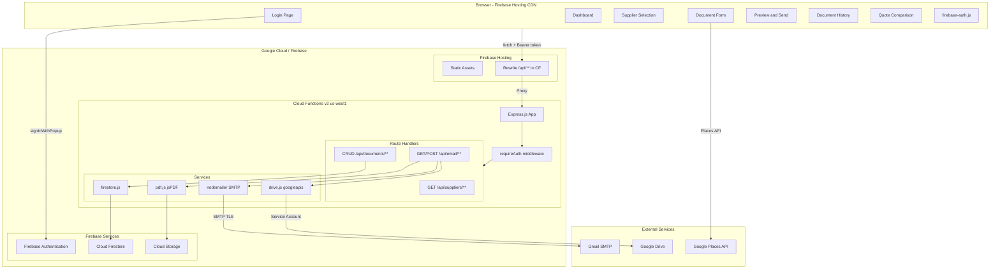
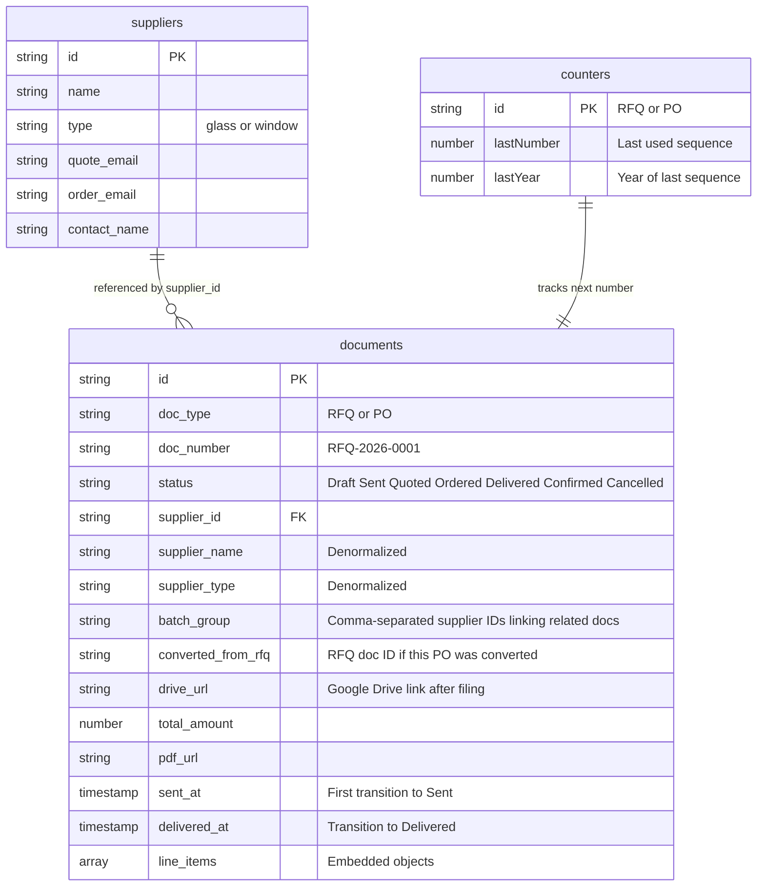
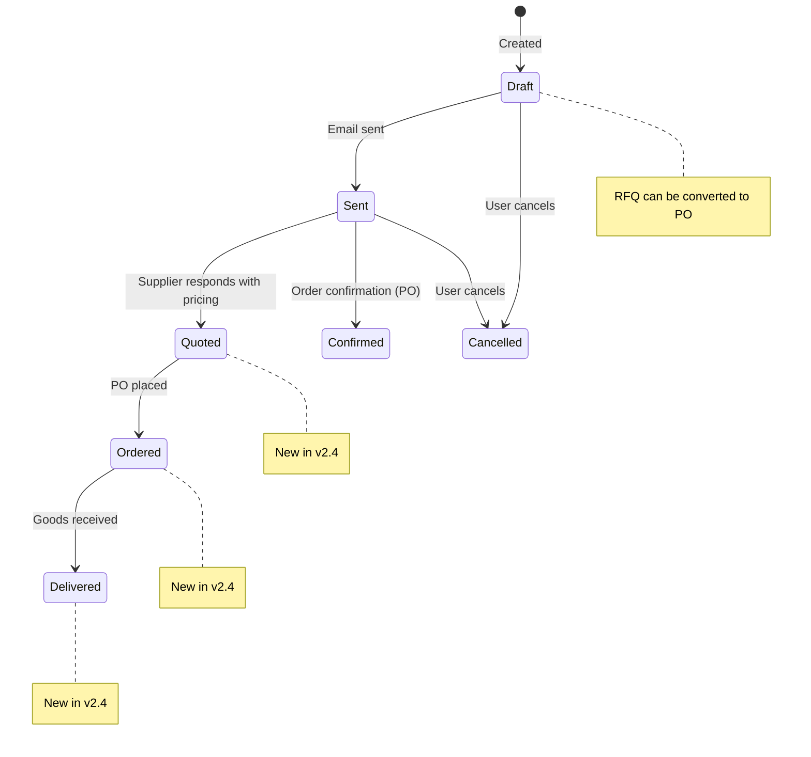
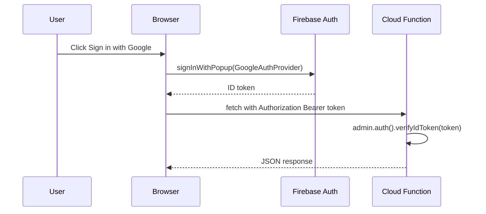
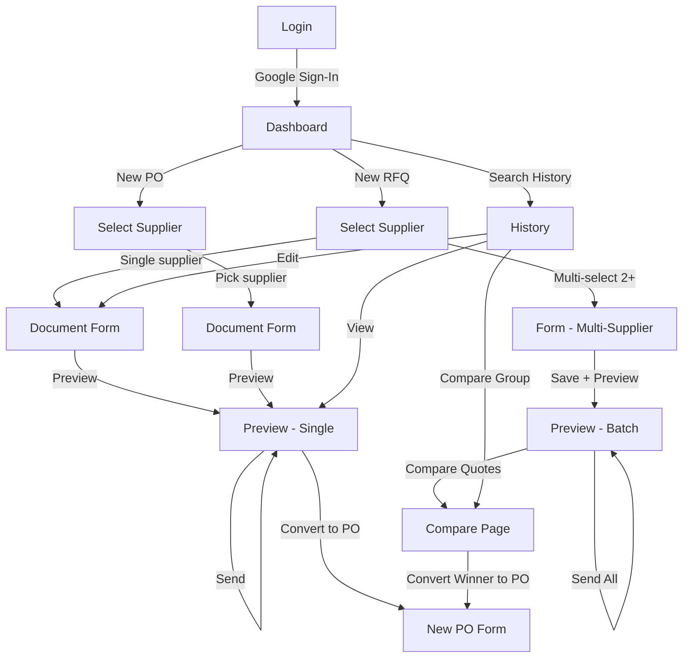
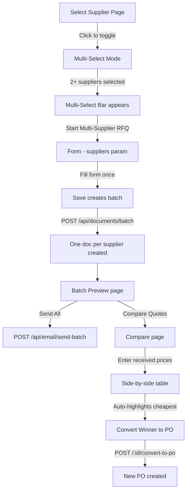
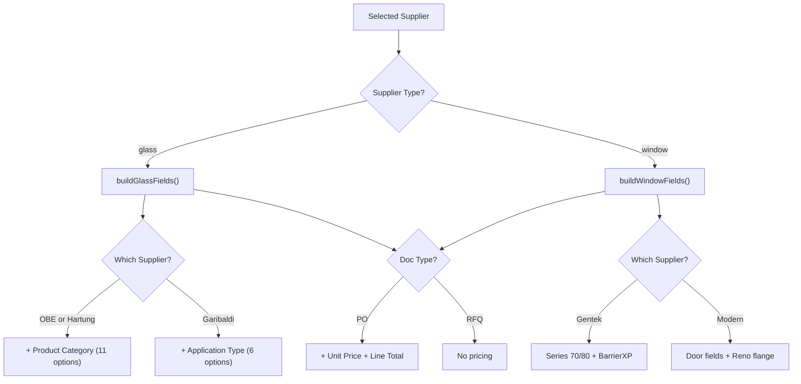

# Western Windows — Ordering & Quoting Portal

## Enterprise Technical Documentation

**Application:** Western Windows Supplier Portal  
**Version:** 2.4.0 (Firebase Edition — Status Pipeline)  
**Owner:** Western Windows (Windows, Doors & Skylights)  
**Primary User:** Shane  
**Document Date:** March 10, 2026  
**Document Author:** Generated from full source-code audit — no code was modified  

---

## Table of Contents

1. [Executive Summary](#1-executive-summary)
2. [Business Objectives & Success Criteria](#2-business-objectives--success-criteria)
3. [Architecture Overview](#3-architecture-overview)
4. [Technology Stack](#4-technology-stack)
5. [File Inventory](#5-file-inventory)
6. [Data Model](#6-data-model)
7. [API Reference](#7-api-reference)
8. [Authentication System](#8-authentication-system)
9. [PDF Generation Pipeline](#9-pdf-generation-pipeline)
10. [Google Drive Integration](#10-google-drive-integration)
11. [Email Delivery System](#11-email-delivery-system)
12. [Frontend Screen Map & User Flows](#12-frontend-screen-map--user-flows)
13. [Multi-Supplier RFQ Workflow](#13-multi-supplier-rfq-workflow)
14. [Quote Comparison Engine](#14-quote-comparison-engine)
15. [Form Engine — Supplier-Aware Logic](#15-form-engine--supplier-aware-logic)
16. [Supplier Catalog](#16-supplier-catalog)
17. [CSS Design System](#17-css-design-system)
18. [Security Model](#18-security-model)
19. [Deployment & Infrastructure](#19-deployment--infrastructure)
20. [Environment Configuration](#20-environment-configuration)
21. [Company Landing Page](#21-company-landing-page)
22. [Operational Runbook](#22-operational-runbook)
23. [Known Gaps & Future Roadmap](#23-known-gaps--future-roadmap)
24. [Roadmap & Project Planning](#24-roadmap--project-planning)
25. [Changelog](#25-changelog)

---

## 1. Executive Summary

The **Western Windows Portal** is an internal web application that replaces manual, email-based procurement workflows with a structured, branded system for creating, managing, and sending **Requests for Quote (RFQs)** and **Purchase Orders (POs)** to glass, window, and door suppliers.

### What's New in v2.2

| Feature | Description |
|---------|-------------|
| **Multi-Supplier RFQ** | Select 2+ suppliers → one form → creates separate RFQs for each supplier simultaneously |
| **Batch Send** | Send all RFQs from a multi-supplier group in one click |
| **Quote Comparison** | Enter received prices side-by-side, auto-highlight cheapest per line, see totals |
| **RFQ → PO Conversion** | Convert winning quote directly into a Purchase Order with one click |
| **Google Drive Filing** | PDFs auto-filed into organized folder structure: `Root / YYYY / Month / Project / doc.pdf` |
| **Quote Price Tracking** | Save received prices on RFQ line items for comparison |
| **Dashboard Quick Stats** | Live KPI cards: Drafts Pending, RFQs Sent, POs This Month, PO Value |
| **Duplicate Document** | "Copy as New" button on history rows — instant document cloning |
| **Default Requested By** | Remembers last entered name via localStorage |
| **Status Pipeline** | Expanded: Draft → Sent → Quoted → Ordered → Delivered. Inline dropdown on history, pipeline counts on dashboard |

---

## 2. Business Objectives & Success Criteria

### Business Goals

| # | Goal | How the App Addresses It |
|---|------|--------------------------|
| 1 | **Eliminate manual RFQ/PO drafting** | Structured form with supplier-specific fields |
| 2 | **Professional, branded output** | Server-side PDF generation with WW logo, navy headers (#1B3A5C) |
| 3 | **Automatic document numbering** | Transaction-safe sequential: `RFQ-YYYY-NNNN` / `PO-YYYY-NNNN` |
| 4 | **One-click email delivery** | SMTP email with auto-attached PDF |
| 5 | **Document history & search** | Full search/filter with status tracking |
| 6 | **Supplier-specific intelligence** | Fields adapt per supplier |
| 7 | **Order confirmation tracking** | POs store supplier confirmation details |
| 8 | **Multi-supplier quoting** | Send same RFQ to multiple suppliers, compare responses |
| 9 | **Price comparison** | Side-by-side quote comparison with cheapest-per-line highlighting |
| 10 | **Automatic PDF filing** | PDFs auto-filed to Google Drive in organized folder structure |
| 11 | **Dashboard KPIs** | At-a-glance stats: drafts, sent RFQs, monthly POs, monthly spend |
| 12 | **Document duplication** | Clone any document as a new draft with one click |
| 13 | **Status tracking pipeline** | Visual procurement pipeline with inline status changes from document list |

---

## 3. Architecture Overview



### Key Architectural Decisions

1. **Serverless backend** — Cloud Functions scale to zero; no always-on costs
2. **Firestore** — Documents + line items stored as embedded arrays (denormalized)
3. **Firebase Hosting rewrites** — `/api/**` proxies to Cloud Functions (same-origin)
4. **Firebase Auth** — Google Sign-In popup; ID tokens as Bearer headers
5. **Multi-page application** — separate `.html` files; no SPA framework
6. **Lazy initialization** — `jsPDF`, `nodemailer`, `googleapis` loaded lazily to avoid cold-start timeouts
7. **Transaction-safe numbering** — `counters` collection ensures no duplicate doc numbers
8. **Batch document creation** — single API call creates one doc per supplier with linked `batch_group`

---

## 4. Technology Stack

### Backend (Cloud Functions)

| Package | Version | Purpose |
|---------|---------|---------|
| `express` | ^4.21.0 | HTTP routing & middleware |
| `firebase-admin` | ^13.4.0 | Firestore, Auth, Cloud Storage admin |
| `firebase-functions` | ^7.1.0 | Cloud Functions v2 HTTP trigger |
| `jspdf` | ^4.2.0 | Server-side PDF generation |
| `jspdf-autotable` | ^5.0.7 | Table plugin for jsPDF |
| `nodemailer` | ^8.0.1 | SMTP email transport |
| `googleapis` | **^171.4.0** | **Google Drive API** (v2.2 — new) |
| `cors` | ^2.8.6 | CORS with domain allowlist |
| `cookie-session` | ^2.1.0 | Lightweight session (legacy compat) |
| `dotenv` | ^17.3.1 | Local dev `.env` parsing |

**Runtime:** Node.js 22 · **Region:** us-west1 · **Memory:** **512 MiB** · **Timeout:** **120s**

### Frontend

| Technology | Details |
|------------|---------|
| HTML5 | Semantic, multi-page (**7 portal pages** + 1 landing page) |
| Vanilla CSS | **1,268-line** portal design system + **~1,800-line** landing page styles |
| Vanilla JavaScript | ES modules for Firebase Auth; classic scripts for page logic |
| Firebase Auth SDK | v11.6.0 via CDN |
| Google Inter font | 300–800 weights (portal) |
| Google Montserrat/Open Sans | Landing page fonts |
| Google Places API | Address autocomplete on form page |

---

## 5. File Inventory

```
WW apps/
├── .env                          # Local dev environment variables
├── .firebaserc                   # Firebase project alias (western-windows-ca)
├── .gitignore                    # Comprehensive ignore rules
├── firebase.json                 # Hosting, Functions, Firestore, Storage config
├── firestore.rules               # Firestore security rules (deny all client)
├── firestore.indexes.json        # Composite index definitions
├── storage.rules                 # Cloud Storage security rules
│
├── docs/                         # PROJECT DOCUMENTATION
│   ├── ROADMAP.md                #   Feature roadmap & task graph (168 lines)
│   └── plans/                    #   Design documents
│       └── 2026-03-07-google-drive-export-design.md
├── package.json                  # Root manifest (dev scripts only)
│
├── functions/                    # BACKEND — Firebase Cloud Functions
│   ├── package.json              #   Functions manifest (Node 22)
│   ├── index.js                  #   Express app + Cloud Function export
│   ├── auth.js                   #   Firebase Auth middleware (verifyIdToken)
│   ├── firestore.js              #   Data access layer — 25 exported functions (298 lines)
│   ├── pdf.js                    #   PDF generation engine (275 lines)
│   ├── drive.js                  #   ★ NEW: Google Drive integration (188 lines)
│   ├── ww-logo.png               #   Logo for PDF header (optimized)
│   └── routes/
│       ├── auth.js               #     Auth routes (login, logout, check)
│       ├── documents.js          #     Document CRUD + batch + convert + status (365 lines)
│       ├── email.js              #     PDF gen, email send + batch send + Drive (275 lines)
│       └── suppliers.js          #     Supplier list + lookup
│
└── src/                          # FRONTEND — Firebase Hosting
    ├── index.html                #   Company landing page (~1,400 lines, SEO)
    ├── script.js                 #   Landing page JS (290 lines)
    ├── styles.css                #   Landing page CSS (~1,800 lines)
    ├── logo.png                  #   Company logo
    ├── nsccr-logo.png            #   Partner/association logo
    └── portal/
        ├── index.html            #   Login — Google Sign-In
        ├── dashboard.html        #   Dashboard — stats + pipeline + action cards (118 lines)
        ├── select-supplier.html  #   Supplier picker — multi-select for RFQ
        ├── form.html             #   Document form + Google Places
        ├── preview.html          #   PDF preview + send + batch send
        ├── history.html          #   Search/filter + inline status + results + confirm modal
        ├── compare.html          #   ★ NEW: Quote comparison page
        ├── ww-logo.png           #   Portal logo
        ├── css/
        │   └── styles.css        #   Portal design system (1,418 lines)
        └── js/
            ├── firebase-auth.js  #   Firebase Auth init + helpers (ES module)
            ├── utils.js          #   apiFetch, toasts, auth check, formatters
            ├── dashboard.js      #   Dashboard — stats + pipeline + recent activity (132 lines)
            ├── supplier.js       #   Supplier selection + multi-select (143 lines)
            ├── form.js           #   CORE: Form engine (877 lines)
            ├── preview.js        #   Preview + batch preview + convert (391 lines)
            ├── history.js        #   History — search, results, status dropdown, duplicate (245 lines)
            └── compare.js        #   ★ NEW: Quote comparison logic (268 lines)
```

### Source Code Statistics

| Layer | Files | Total Lines |
|-------|-------|-------------|
| Backend (`functions/`) | **10** `.js` files | **~1,600** |
| Frontend HTML | **7** portal `.html` + 1 landing `.html` | **~2,040** |
| Frontend JS | **8** portal `.js` + 1 landing `.js` | **~2,680** |
| Frontend CSS | 2 `.css` files | **~3,220** |
| Docs | 2 `.md` files | **~180** |
| **TOTAL** | **~30 source files** | **~9,720 lines** |

---

## 6. Data Model

### Firestore Collections

Three top-level collections: `suppliers`, `documents`, and `counters`.



### New Fields (v2.2–2.4)

| Field | Type | Description |
|-------|------|-------------|
| `batch_group` | string | Comma-separated supplier IDs linking multi-supplier RFQ docs |
| `converted_from_rfq` | string | Source RFQ document ID when PO was created via conversion |
| `drive_url` | string | Google Drive web view link after auto-filing |
| `quoted_price` | number | On line items — received price from supplier (for comparison) |
| `sent_at` | timestamp | Set on first transition to Sent status (v2.4) |
| `delivered_at` | timestamp | Set on transition to Delivered status (v2.4) |

### Document Status Lifecycle



**Valid statuses:** `Draft`, `Sent`, `Quoted`, `Ordered`, `Delivered`, `Confirmed`, `Cancelled`

---

## 7. API Reference

### Base URL

| Environment | URL |
|-------------|-----|
| **Local Dev** | `http://localhost:3000/api` |
| **Production** | `https://western-windows-ca.web.app/api` |

All endpoints (except health/auth-check) require a Firebase Auth **Bearer token**.

### Endpoints

| Endpoint | Method | Description |
|----------|--------|-------------|
| `/api/health` | GET | Health check (no auth) |
| `/api/auth/check` | GET | Auth status check |
| `/api/suppliers` | GET | List all (optional `?type=glass\|window`) |
| `/api/suppliers/:id` | GET | Single supplier |
| `/api/documents` | GET | Search with filters |
| `/api/documents` | POST | Create single document |
| `/api/documents/batch` | POST | **NEW:** Create one doc per supplier (multi-supplier RFQ) |
| `/api/documents/next-number/:type` | GET | Next sequential number |
| `/api/documents/recent/list` | GET | 10 most recent (dashboard) |
| `/api/documents/:id` | GET | Get by ID |
| `/api/documents/:id` | PUT | Update document |
| `/api/documents/:id` | DELETE | Delete document |
| `/api/documents/:id/confirmation` | PATCH | Update PO order confirmation |
| `/api/documents/:id/status` | PATCH | **NEW v2.4:** Quick status update (validated enum) |
| `/api/documents/:id/convert-to-po` | POST | Convert RFQ → PO |
| `/api/documents/:id/quote-prices` | PATCH | **NEW:** Save received prices on line items |
| `/api/documents/batch-group/:group` | GET | **NEW:** Get all docs in a batch group |
| `/api/email/pdf-preview/:id` | GET | Generate PDF (inline) |
| `/api/email/pdf/:id` | GET | Generate PDF (download) |
| `/api/email/send/:id` | POST | Generate PDF → Storage → Drive → Email |
| `/api/email/send-batch` | POST | **NEW:** Send multiple docs in one call |

### New Endpoints Detail

**`POST /api/documents/batch`**
```json
{
  "document": { "doc_type": "RFQ", "project_name": "...", ... },
  "lineItems": [...],
  "supplier_ids": ["id1", "id2", "id3"]
}
```
Creates one RFQ per supplier, each with its own doc number. All linked via `batch_group`.

**`POST /api/documents/:id/convert-to-po`**
Copies an RFQ into a new PO document with a new PO number. Sets `quote_reference` to the original RFQ number and `converted_from_rfq` to the RFQ's ID. Copies all line items including `quoted_price` as `unit_price`.

**`PATCH /api/documents/:id/quote-prices`**
```json
{
  "prices": [
    { "line_number": 1, "quoted_price": 125.50 },
    { "line_number": 2, "quoted_price": 89.00 }
  ]
}
```

**`PATCH /api/documents/:id/status`** *(New in v2.4)*
```json
{ "status": "Quoted" }
```
Validated against: `Draft`, `Sent`, `Quoted`, `Ordered`, `Delivered`, `Confirmed`, `Cancelled`. Smart timestamps: sets `sent_at` on first Sent, `delivered_at` on Delivered.

---

## 8. Authentication System



**Key files:** `firebase-auth.js` (frontend), `auth.js` (backend middleware), `utils.js` (`apiFetch()` auto-injects Bearer token)

---

## 9. PDF Generation Pipeline

| Section | Content |
|---------|---------|
| **Header** | WW logo + title + doc number |
| **From/To** | Two-column: Western Windows ↔ Supplier |
| **Details** | Date, Required By, Project, Requested By, Shipping |
| **Line Items** | Glass or Window layout with supplier-specific columns |
| **Total** | PO only: right-aligned total |
| **Notes** | Free-text special instructions |
| **Footer** | Company contact info |

---

## 10. Google Drive Integration

**File:** `functions/drive.js` — 188 lines (new in v2.2)

### Folder Structure

```
{Root Folder} /
  └── 2026 /
      └── March /
          └── Project Name /
              ├── RFQ-2026-0001 — Gentek.pdf
              └── PO-2026-0002 — Modern.pdf
```

### How It Works

1. On email send, after PDF is generated and saved to Cloud Storage
2. `uploadPDF()` is called with the PDF buffer and document metadata
3. Builds folder path: `Root → Year → Month → Project Name`
4. Each folder is created if it doesn't exist (`findOrCreateFolder()` with in-memory caching)
5. Checks for existing file (avoids duplicates on re-send) — updates if found, creates if not
6. Returns Google Drive `webViewLink` → saved to document as `drive_url`

### Authentication

- Uses a **service account** with **domain-wide delegation**
- Service account key stored as `DRIVE_SA_KEY` secret (JSON)
- Impersonates a workspace user via `DRIVE_IMPERSONATE_EMAIL`
- Root folder ID specified via `DRIVE_ROOT_FOLDER_ID` secret

### Graceful Degradation

If `DRIVE_ROOT_FOLDER_ID` is not set, Drive upload is silently skipped. If the Drive API call fails, it logs a warning but does not block the email send.

---

## 11. Email Delivery System

1. Generate PDF → buffer
2. Save to Cloud Storage: `portal/pdfs/{doc_number}.pdf`
3. **Auto-file to Google Drive** (new in v2.2) → save `drive_url`
4. Check SMTP config — if unconfigured: graceful degradation
5. Send with HTML body (`escapeHtml()` on all user content) + PDF attachment
6. Update status to `Sent`

### Batch Send (`POST /api/email/send-batch`)

Accepts `{ ids: ["id1", "id2", ...] }`. Iterates over each document, generates PDF, files to Drive, sends email. Returns per-document success/failure results.

---

## 12. Frontend Screen Map & User Flows



### Pages (7 portal + 1 landing)

| Page | File | Key Features |
|------|------|-------------|
| Login | `portal/index.html` | Google Sign-In, auto-redirect |
| Dashboard | `portal/dashboard.html` | **Quick stats cards**, **pipeline visualization**, action cards, recent activity |
| Select Supplier | `portal/select-supplier.html` | **Multi-select for RFQ** (toggle cards), single-select for PO |
| Document Form | `portal/form.html` | Dynamic fields, multi-supplier, **duplicate loading**, Google Places |
| Preview | `portal/preview.html` | Single + **batch preview**, download, send, **convert to PO** |
| History | `portal/history.html` | 6-filter search, **inline status dropdown**, duplicate 📋, compare, confirm modal |
| Compare | `portal/compare.html` | Side-by-side price comparison, cheapest highlighting |

---

## 13. Multi-Supplier RFQ Workflow

This is the flagship new feature in v2.2. The complete flow:



### Supplier Selection (Multi-Select)

- **RFQ mode:** Clicking a supplier card toggles selection (`.supplier-selected` class)
- **PO mode:** Clicking navigates directly to form (single-select)
- **Multi-select bar:** Appears when 1+ suppliers selected; shows count and "Start Multi-Supplier RFQ" button
- **Single selected:** Uses normal single-supplier flow
- **Multiple selected:** Passes comma-separated IDs as `?suppliers=id1,id2,id3`

### Form (Multi-Supplier Aware)

- `form.js` detects `?suppliers=` param and loads all supplier objects
- Displays supplier chips/list in header
- Uses **first supplier** to determine field types (all suppliers in a multi-select should be same type)
- On save: calls `POST /api/documents/batch` instead of regular create

### Batch Preview

- `preview.js` detects `?batch=id1,id2,id3` param
- Loads all documents and shows them in a tabbed/listed view
- **Send All** button calls `POST /api/email/send-batch`
- **Compare Quotes** button navigates to comparison page

---

## 14. Quote Comparison Engine

**Files:** `compare.html` (61 lines) + `compare.js` (268 lines)

### How It Works

1. Page loads documents by `?group=` (batch group) or `?ids=id1,id2` (explicit IDs)
2. Renders a comparison table: columns = suppliers, rows = line items
3. User enters received `quoted_price` for each line item per supplier
4. **Auto-calculates** totals per supplier column
5. **Auto-highlights** cheapest price per line (green)
6. Shows overall cheapest supplier
7. **Save Prices** button: `PATCH /api/documents/:id/quote-prices` for each doc
8. **Convert Winner to PO** button: `POST /api/documents/:id/convert-to-po`

### Key Functions

| Function | Purpose |
|----------|---------|
| `loadByBatchGroup(group)` | Fetch all docs in a batch group |
| `loadByIds(ids)` | Fetch docs by explicit ID list |
| `renderComparison()` | Build the comparison table dynamically |
| `updateTotals()` | Recalculate line totals and grand totals on price input |
| `highlightCheapestPerLine()` | Green-highlight lowest price per row |
| `savePrices()` | Persist entered prices to Firestore |
| `convertWinnerToPO(docId)` | Convert the cheapest supplier's RFQ to a PO |

---

## 15. Form Engine — Supplier-Aware Logic

`form.js` — **855 lines** (was 764), the most complex component.



### New in v2.2/v2.3

| Feature | Description |
|---------|-------------|
| `multiSupplierIds` / `multiSuppliers` | State variables for multi-supplier mode |
| `loadMultiSuppliers(ids)` | Fetches all supplier objects, configures form header |
| Batch save in `saveDraft()` | Calls `/api/documents/batch` when `multiSupplierIds.length > 1` |
| `?duplicate=ID` param | Loads existing document as a new draft (clears ID, gets new doc number) |
| Default `requested_by` | Saves last used name to `localStorage`, pre-fills on next form load |
| Batch preview navigation | After batch save, redirects to `preview.html?batch=id1,id2,...` |

---

## 16. Supplier Catalog

### Glass Suppliers

| Supplier | Quote Email | Order Email | Special Fields |
|----------|------------|-------------|----------------|
| Old Castle (OBE) | lanquotes@obe.com | lanorders@obe.com | Product Category (11 opts) |
| Hartung Glass | bbyquotes@hartung-glass.com | burnaby.glass@hartung-glass.com | Product Category (11 opts) |
| Garibaldi Glass | sales@garibaldiglass.com | orders@garibaldiglass.com | Application Type (6 opts) |

### Window & Door Suppliers

| Supplier | Contact | Special Fields |
|----------|---------|----------------|
| Gentek | Blair Gracie | Series: 70/80. Glass: BarrierXP variants |
| Modern Windows | Maegan | Door fields, Reno flange, Series: Vinyl/Aluminum/TB-Alum |

> [!NOTE]
> The seed script creates 5 suppliers. A 6th supplier may be added manually via Firebase Console (the roadmap references 6 total: 3 glass, 3 windows & doors).

---

## 17. CSS Design System

**Portal:** `styles.css` — **1,418 lines** (was 1,268)

### Brand Palette

| Token | Hex | Usage |
|-------|-----|-------|
| `--navy` | `#1B3A5C` | Primary brand, headers |
| `--blue` | `#4682B4` | Focus states, gradients |
| `--blue-light` | `#6AAFE6` | Accent text, badges |
| `--amber` | `#F5A623` | Action buttons, PO badge, prices |
| `--bg-primary` | `#0D1B2A` | Page background (dark theme) |

### Component Library

Buttons (7 variants) · Cards · Badges (7 status/type variants) · Forms (grid layouts) · Tables · Toasts (4 types) · Modal · Spinner · Line Items Editor · Stat cards · **Status select dropdown** (7 color variants) · **Pipeline visualization** (5-stage grid, responsive) · Google Places autocomplete · Supplier multi-select · Comparison table styles

---

## 18. Security Model

| Aspect | Implementation | Rating |
|--------|---------------|--------|
| **Authentication** | Firebase Auth + Google Sign-In | ✅ |
| **Token Verification** | `verifyIdToken()` on every API call | ✅ |
| **CORS** | Domain allowlist (localhost, `.web.app`, `.firebaseapp.com`, `westernwindows.ca`) | ✅ |
| **Firestore Rules** | `allow read, write: if false` | ✅ |
| **XSS (Frontend)** | `esc()` HTML-encodes all user content | ✅ |
| **XSS (Email)** | Server-side `escapeHtml()` on email templates | ✅ |
| **Content-Disposition** | `safeFilename()` sanitizes filenames | ✅ |
| **Express Hardening** | `x-powered-by` disabled | ✅ |
| **Input Validation** | `normalizeLineItems()` + 400 errors for missing fields | ✅ |
| **Drive Auth** | Service account with domain-wide delegation, key in Secret Manager | ✅ |
| **Drive Folder Names** | Sanitized: `replace(/[/\\<>:"|?*]/g, '_')` | ✅ |
| **Storage Rules** | PDFs publicly readable by URL | ⚠️ |

---

## 19. Deployment & Infrastructure

### Cloud Function Properties

| Property | Value |
|----------|-------|
| Function name | `api` |
| Region | `us-west1` |
| Timeout | **120 seconds** (was 60) |
| Memory | **512 MiB** (was 256) |
| Secrets | `SMTP_HOST`, `SMTP_PORT`, `SMTP_USER`, `SMTP_PASS`, `EMAIL_FROM`, `EMAIL_CC`, **`DRIVE_ROOT_FOLDER_ID`**, **`DRIVE_IMPERSONATE_EMAIL`**, **`DRIVE_SA_KEY`** |

### Commands

```bash
firebase deploy              # Everything
firebase deploy --only functions
firebase deploy --only hosting
npm run dev                  # Local dev → http://localhost:3000
```

---

## 20. Environment Configuration

| Variable | Default | Description |
|----------|---------|-------------|
| `LOCAL_DEV` | `true` | Enables local static serving |
| `PORT` | `3000` | HTTP port |
| `SMTP_HOST` | `smtp.gmail.com` | SMTP server |
| `SMTP_PORT` | `587` | SMTP port |
| `SMTP_USER` | `info@westernwindows.ca` | SMTP auth |
| `SMTP_PASS` | placeholder | Gmail app password |
| `EMAIL_FROM` | `info@westernwindows.ca` | Sender |
| `EMAIL_CC` | `shane@westernwindows.ca` | CC on all outbound |
| **`DRIVE_ROOT_FOLDER_ID`** | — | Google Drive root folder ID |
| **`DRIVE_IMPERSONATE_EMAIL`** | — | Workspace user to impersonate |
| **`DRIVE_SA_KEY`** | — | Service account key JSON |

> [!WARNING]
> In production, all secrets are **Google Cloud Secrets** — not `.env`. Missing Drive secrets trigger graceful degradation (Drive filing skipped).

---

## 21. Company Landing Page

**File:** `src/index.html` — ~1,400 lines (53 KB)

| Section | Features |
|---------|----------|
| **SEO** | Title tags, meta descriptions, OG tags, Twitter cards |
| **Schema.org** | `HomeAndConstructionBusiness` structured data |
| **Hero** | Animated stat counters, CTA buttons |
| **Services** | Windows, Doors, Skylights |
| **Gallery** | CSS grid image gallery with overlays |
| **Testimonials** | Carousel with navigation dots |
| **Contact** | Google Forms integration with client-side validation |
| **Accessibility** | Skip-to-content link, ARIA labels, semantic HTML |
| **JS** | `script.js` — 290 lines (nav scroll, stats animation, testimonial slider, form validation) |
| **CSS** | `styles.css` — ~1,800 lines (32 KB) |

---

## 22. Operational Runbook

### Local Development

```bash
cd "c:\Users\shane\AntiG\WW apps"
npm run dev
# Portal → http://localhost:3000/portal/
# Website → http://localhost:3000/
```

### Supplier Seeding

Auto-seeds on first request if `suppliers` collection is empty.

### Monitoring

- **Logs:** Firebase Console → Functions → Logs
- **Data:** Firebase Console → Firestore Database
- **Storage:** Firebase Console → Storage (`portal/pdfs/`)
- **Drive:** Check organized folder structure in shared Drive
- **Health:** `GET /api/health`

---

## 23. Known Gaps & Future Roadmap

### ✅ Fully Implemented

| Feature | Status |
|---------|--------|
| Google Sign-In authentication | ✅ |
| Dashboard with **quick stats** + recent activity | ✅ |
| Supplier selection (5+ suppliers, 2 types) | ✅ |
| Dynamic forms — glass (3 variants) + window (2 variants) | ✅ |
| Transaction-safe document numbering | ✅ |
| Save draft / edit existing / **duplicate** | ✅ |
| PDF generation (glass + window layouts) | ✅ |
| PDF preview, download, email send | ✅ |
| SMTP graceful degradation | ✅ |
| Document history with 6-parameter search | ✅ |
| Order confirmation modal (POs) | ✅ |
| XSS protection (frontend + backend) | ✅ |
| CORS domain allowlist | ✅ |
| Input validation | ✅ |
| Company landing page with full SEO | ✅ |
| Multi-supplier RFQ (batch create) | ✅ |
| Batch email send | ✅ |
| Quote comparison page | ✅ |
| RFQ → PO conversion | ✅ |
| Quote price tracking | ✅ |
| Google Drive auto-filing | ✅ |
| **Dashboard quick stats (4 KPI cards)** | ✅ |
| **Duplicate document ("Copy as New")** | ✅ |
| **Default "Requested By" via localStorage** | ✅ |
| **Status tracking pipeline** | ✅ New |
| **Inline status dropdown on history** | ✅ New |
| **Dashboard pipeline visualization** | ✅ New |
| Google Places API key fix | ✅ Bug fix |
| convertToPO double-parse fix | ✅ Bug fix |

### 🔲 Known Bugs

| # | Issue | Severity |
|---|-------|----------|
| B2 | Firebase Storage not configured for project — `deploy --only storage` fails | 🟡 Medium |
| B3 | Old batch RFQs missing `batch_group` field — compare button won't appear | 🟡 Medium |
| B4 | Intermittent deploy cold start timeouts — `googleapis` heavy at import time | 🟡 Medium |

### 🔲 Planned Features (from `docs/ROADMAP.md`)

| Phase | Features |
|-------|----------|
| **Phase 2** | ~~Status tracking pipeline~~, email response tracking, document templates, bulk actions, enhanced PDF |
| **Phase 3** | Supplier price history, monthly spend report, project tracker, CSV/Excel export |
| **Phase 4** | Supplier portal (read-only), recurring orders, multi-user support, mobile form, notifications |
| **Phase 5** | QuickBooks sync, inventory awareness, AI suggestions, backup & DR |

### 🔲 Known Gaps

| Gap | Severity |
|-----|----------|
| No supplier management UI | Medium |
| Modern door fields hidden by default | Medium |
| No pagination on history (capped at 100) | Low |
| No duplicate-detection on rapid submission | Low |
| No reporting / analytics dashboard | Medium |
| PDFs publicly readable in Cloud Storage | Low |
| Legacy session auth routes still wired | Low |

---

## 24. Roadmap & Project Planning

**File:** `docs/ROADMAP.md` — 177 lines

The project maintains a structured roadmap organized by **ROI vs effort**, not technical domain:

| Phase | Theme | Status |
|-------|-------|--------|
| ✅ **Phase 1** | Quick Wins (< 1 hour each) | **Shipped** — stats, duplicate, default fields, bug fixes |
| 🟡 **Phase 2** | Workflow Improvements | **In Progress** — status pipeline ✅, remaining: templates, bulk actions, enhanced PDF |
| 📋 **Phase 3** | Business Intelligence | Planned — spend reports, price history, project tracker |
| 📋 **Phase 4** | Advanced Features | Planned — supplier portal, multi-user, mobile |
| 📋 **Phase 5** | Integration & Scale | Planned — QuickBooks, inventory, AI |

### Decision Log (from roadmap)

| Date | Decision | Rationale |
|------|----------|-----------|
| 2026-03-07 | Consolidate landing page + portal on single Firebase project | Simpler infrastructure, one deploy, one domain |
| 2026-03-07 | JWT auth for Drive (not domain-wide delegation) | More secure, dedicated SA key in secrets |
| 2026-03-08 | `batch_group` as comma-separated supplier IDs | Simple, no additional collection needed |
| 2026-03-08 | Compare page uses document IDs from URL params | Stateless — works from batch preview or documents list |
| 2026-03-09 | Roadmap organized by ROI, not technical domain | Business value drives priority |
| 2026-03-10 | Status pipeline as inline dropdowns, not separate page | Less clicks = faster daily workflow, fits in existing table |

---

## 25. Changelog

### v2.4.0 (March 10, 2026)

| Change | Details |
|--------|---------|
| **Status tracking pipeline** | Expanded enum: Draft → Sent → Quoted → Ordered → Delivered (+ Confirmed, Cancelled) |
| **Dashboard pipeline visualization** | 5-stage colored grid showing document counts per status |
| **Inline status dropdown** | Change status from history table without opening the document |
| **PATCH `/documents/:id/status`** | New API endpoint with validated status enum |
| **`updateDocumentStatus()`** | New Firestore function with smart timestamps (`sent_at`, `delivered_at`) |
| **CSS status-select component** | 7 color-coded variants (Draft=yellow, Sent=blue, Quoted=purple, Ordered=amber, Delivered=green, Cancelled=red) |
| **CSS pipeline-grid component** | 5-column responsive grid with color-coded stage counts |
| **Cache-busting** | `?v=2` query strings on CSS + JS references |
| **dashboard.html** | Pipeline visualization added (91 → 118 lines) |
| **dashboard.js** | Pipeline counts + loading (113 → 132 lines) |
| **history.js** | Inline status `<select>` in table rows (216 → 245 lines) |
| **firestore.js** | `updateDocumentStatus()` with smart timestamps (284 → 298 lines) |
| **documents.js** | PATCH `/status` endpoint (348 → 365 lines) |
| **styles.css** | Status-select + pipeline components (1,268 → 1,418 lines) |
| **Branch merged** | `feature/migrate-to-domain` → `master` |

### v2.3.0 (March 9, 2026)

| Change | Details |
|--------|---------|
| **Dashboard quick stats** | 4 KPI cards: Drafts Pending, RFQs Sent, POs This Month, PO Value (Month) |
| **Duplicate document** | 📋 "Copy as New" button on every history row via `?duplicate=ID` param |
| **Default "Requested By"** | Last used name saved to `localStorage`, pre-fills on new documents |
| **Bug fix: Places API key** | Added `westernwindows.ca` to allowed referrers in GCP Console |
| **Bug fix: convertToPO** | Fixed double `res.json()` parse in `preview.js` |
| **Landing page expansion** | HTML grew to ~1,400 lines (53 KB), CSS to ~1,800 lines (32 KB) |
| **docs/ directory** | Added `ROADMAP.md` (168 lines) + `plans/` for design documents |
| **dashboard.html** | Stats grid with 4 stat cards added (71 → 91 lines) |
| **dashboard.js** | `loadStats()` function added (79 → 113 lines) |
| **form.js** | Duplicate loading + localStorage requested_by (855 → 877 lines) |
| **history.js** | `duplicateDocument()` + `compareGroup()` added (206 → 216 lines) |

### v2.2.0 (March 8, 2026)

| Change | Details |
|--------|---------|
| **Google Drive integration** | `drive.js` — auto-files PDFs into `Year/Month/Project/` folder structure |
| **Multi-supplier RFQ** | Select 2+ suppliers, create batch of linked RFQs from one form |
| **Batch send** | `POST /api/email/send-batch` — send multiple docs in one API call |
| **Quote comparison** | `compare.html` + `compare.js` — side-by-side pricing with cheapest highlighting |
| **RFQ → PO conversion** | `POST /api/documents/:id/convert-to-po` — one-click conversion |
| **Quote price tracking** | `PATCH /api/documents/:id/quote-prices` — save received prices |
| **Batch group query** | `GET /api/documents/batch-group/:group` — fetch linked docs |
| **googleapis ^171.4.0** | New dependency for Google Drive API |
| **Memory 256→512 MiB** | Increased for Drive + batch operations |
| **Timeout 60→120s** | Increased for batch send operations |
| **3 new secrets** | `DRIVE_ROOT_FOLDER_ID`, `DRIVE_IMPERSONATE_EMAIL`, `DRIVE_SA_KEY` |

### v2.1.0 (March 7, 2026)

| Change | Details |
|--------|---------|
| Node.js 22 | Runtime upgrade |
| firebase-functions ^7.1.0 | Package upgrade |
| CORS allowlist | Replaced permissive `origin: true` |
| Transaction doc numbering | `counters` collection |
| `normalizeLineItems()` | Input validation helper |
| `escapeHtml()` / `safeFilename()` | Email + download security |
| Root deps cleaned | Removed legacy packages |
| Company website | Landing page |

---

> [!NOTE]
> This document was generated by reading every source file in `c:\Users\shane\AntiG\WW apps\`. **No code was modified** during this documentation effort. Document date: March 9, 2026.
