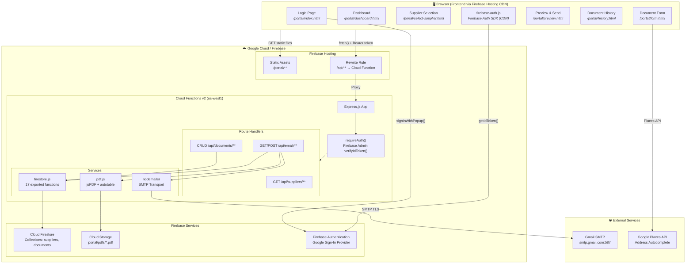
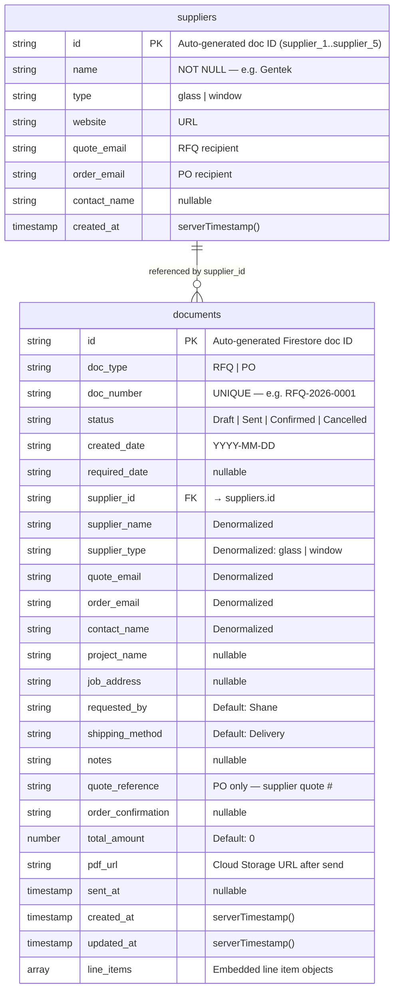
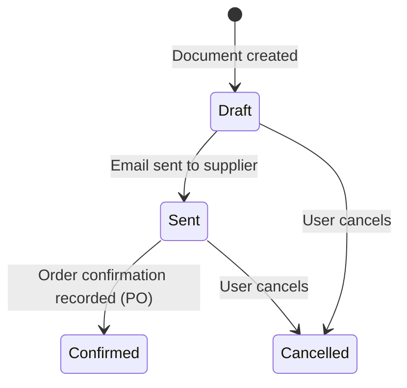
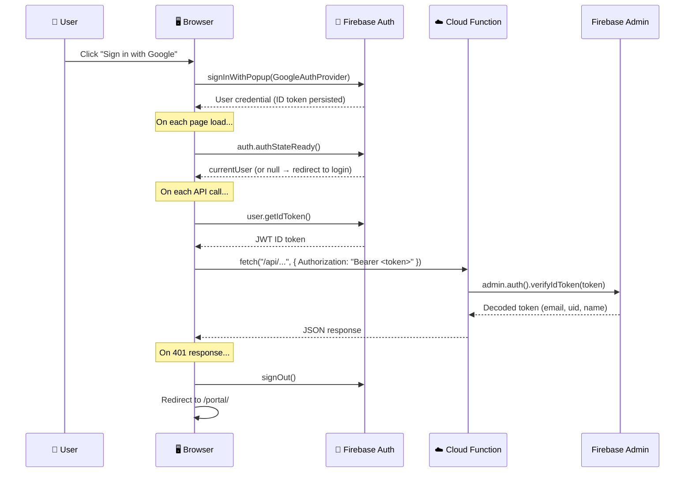
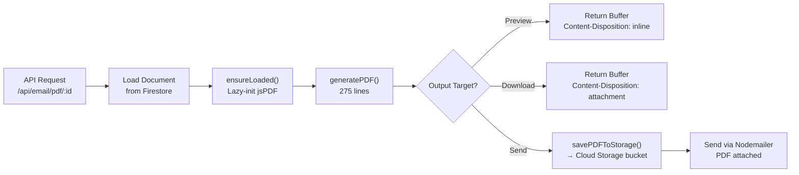
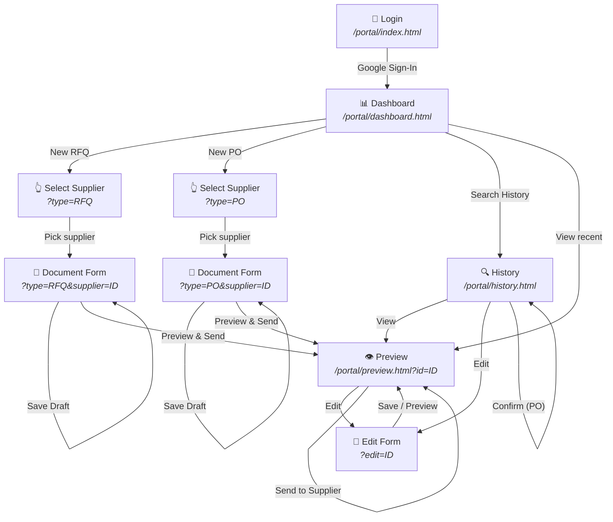
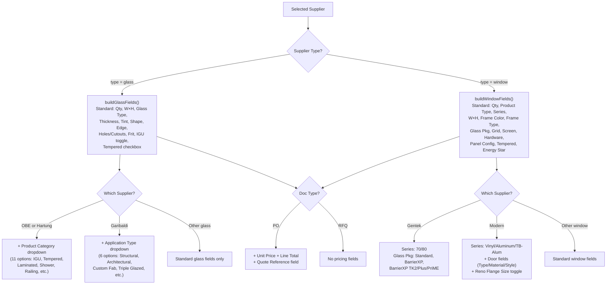

# Western Windows — Ordering & Quoting Portal

## Enterprise Technical Documentation

**Application:** Western Windows Supplier Portal
**Version:** 2.0.0 (Firebase Edition)
**Owner:** Western Windows (Windows, Doors & Skylights)
**Primary User:** Shane
**Document Date:** March 7, 2026
**Document Author:** Generated from full source-code audit — no code was modified

---

## Table of Contents

1. [Executive Summary](#1-executive-summary)
2. [Business Objectives & Success Criteria](#2-business-objectives--success-criteria)
3. [Architecture Overview](#3-architecture-overview)
4. [Technology Stack](#4-technology-stack)
5. [File Inventory](#5-file-inventory)
6. [Data Model](#6-data-model)
7. [API Reference](#7-api-reference)
8. [Authentication System](#8-authentication-system)
9. [PDF Generation Pipeline](#9-pdf-generation-pipeline)
10. [Email Delivery System](#10-email-delivery-system)
11. [Frontend Screen Map & User Flows](#11-frontend-screen-map--user-flows)
12. [Form Engine — Supplier-Aware Logic](#12-form-engine--supplier-aware-logic)
13. [Supplier Catalog](#13-supplier-catalog)
14. [CSS Design System](#14-css-design-system)
15. [Security Model](#15-security-model)
16. [Deployment & Infrastructure](#16-deployment--infrastructure)
17. [Environment Configuration](#17-environment-configuration)
18. [Operational Runbook](#18-operational-runbook)
19. [Known Gaps & Future Roadmap](#19-known-gaps--future-roadmap)
20. [Appendix A — Legacy Architecture](#appendix-a--legacy-architecture)

---

## 1. Executive Summary

The **Western Windows Portal** is an internal web application that replaces manual, email-based procurement workflows with a structured, branded system for creating, managing, and sending **Requests for Quote (RFQs)** and **Purchase Orders (POs)** to glass, window, and door suppliers.

### What Changed Since v1.0

The application underwent a **full re-architecture** from v1.0 to v2.0:

| Aspect | v1.0 (Legacy) | v2.0 (Current) |
|--------|---------------|-----------------|
| **Backend** | Express + SQLite (single process) | Firebase Cloud Functions (serverless) |
| **Database** | SQLite file (`portal.db`) | Cloud Firestore (NoSQL) |
| **Auth** | Session cookies + plaintext `.env` credentials | Firebase Authentication + Google Sign-In |
| **PDF Storage** | Local filesystem (`server/data/pdfs/`) | Firebase Cloud Storage |
| **Hosting** | `node server/index.js` on localhost | Firebase Hosting (CDN) |
| **Deploy** | Manual `node` process | `firebase deploy` (CI-ready) |
| **Frontend** | `src/*.html` at root | `src/portal/*.html` (nested under `/portal/`) |

> [!IMPORTANT]
> The legacy `server/` directory has been **completely removed**. All backend logic now lives in `functions/`.

---

## 2. Business Objectives & Success Criteria

### Core Problem

Western Windows staff manually draft procurement documents for glass, windows, and doors from multiple suppliers. Each supplier has different product catalogs, email addresses, and field requirements. This process is error-prone, untracked, unbranded, and inefficient.

### Business Goals

| # | Goal | How the App Addresses It |
|---|------|--------------------------|
| 1 | **Eliminate manual RFQ/PO drafting** | Structured form with supplier-specific fields auto-populates based on supplier type |
| 2 | **Professional, branded output** | Server-side PDF generation with WW logo, navy headers (#1B3A5C), and structured tables |
| 3 | **Automatic document numbering** | Sequential numbering: `RFQ-YYYY-NNNN` / `PO-YYYY-NNNN` — no duplicates, no gaps |
| 4 | **One-click email delivery** | SMTP email with PDF auto-attached, sent to correct supplier email address |
| 5 | **Document history & search** | Full search/filter with status tracking (Draft → Sent → Confirmed → Cancelled) |
| 6 | **Supplier-specific intelligence** | Form fields adapt per supplier: Gentek shows series options, Hartung shows product categories, Modern shows door fields |
| 7 | **Order confirmation tracking** | POs can store supplier confirmation details after order placement |

### Success Criteria

- Create a complete RFQ or PO for any supplier in **under 3 minutes**
- Every document assigned a unique, sequential number automatically
- PDFs match Western Windows branding and are emailable with one click
- All documents searchable by type, supplier, status, date, or free text

---

## 3. Architecture Overview



### Key Architectural Decisions

1. **Serverless backend** — Cloud Functions scale to zero; no always-on server costs
2. **Firestore** — Documents and line items stored as embedded arrays (denormalized) for single-read access
3. **Firebase Hosting rewrites** — `/api/**` requests proxy to Cloud Functions (same-origin; avoids CORS)
4. **Firebase Auth** — Google Sign-In popup; ID tokens sent as `Bearer` headers on every API call
5. **Multi-page application** — each screen is a separate `.html` file; no SPA framework
6. **Lazy initialization** — Heavy modules (`jsPDF`, `nodemailer`, `firebase-admin`) loaded lazily to avoid cold-start timeouts

---

## 4. Technology Stack

### Backend (Cloud Functions)

| Package | Version | Purpose |
|---------|---------|---------|
| `express` | ^4.21.0 | HTTP routing & middleware |
| `firebase-admin` | ^13.4.0 | Firestore, Auth, Cloud Storage admin access |
| `firebase-functions` | ^6.3.2 | Cloud Functions v2 HTTP trigger |
| `jspdf` | ^4.2.0 | Server-side PDF document generation |
| `jspdf-autotable` | ^5.0.7 | Table plugin for jsPDF |
| `nodemailer` | ^8.0.1 | SMTP email transport |
| `cors` | ^2.8.6 | CORS headers middleware |
| `cookie-session` | ^2.1.0 | Lightweight session (legacy compat) |
| `dotenv` | ^17.3.1 | Local dev `.env` parsing |

**Runtime:** Node.js 20 · **Region:** us-west1 · **Memory:** 256 MiB · **Timeout:** 60s

### Frontend

| Technology | Details |
|-----------|---------|
| HTML5 | Semantic, multi-page (6 pages) |
| Vanilla CSS | 1,024-line design system with CSS custom properties |
| Vanilla JavaScript | ES modules for Firebase Auth; classic scripts for page logic |
| Firebase Auth SDK | v11.6.0 via CDN (`gstatic.com`) |
| Google Inter font | 300–800 weights via Google Fonts |
| Google Places API | Address autocomplete on form page |

### Infrastructure

| Service | Purpose |
|---------|---------|
| Firebase Hosting | CDN-backed static file hosting |
| Cloud Functions v2 | Serverless Express API |
| Cloud Firestore | NoSQL document database |
| Cloud Storage | PDF file storage |
| Firebase Authentication | Google Sign-In identity provider |
| Google Cloud Secret Manager | SMTP credentials (`SMTP_HOST`, `SMTP_PORT`, `SMTP_USER`, `SMTP_PASS`, `EMAIL_FROM`, `EMAIL_CC`) |

---

## 5. File Inventory

### Project Root: `c:\Users\shane\AntiG\WW apps\`

```
WW apps/
├── .env                          # Local dev environment variables
├── .firebaserc                   # Firebase project alias (western-windows-ca)
├── firebase.json                 # Hosting, Functions, Firestore, Storage config
├── firestore.rules               # Firestore security rules (deny all client access)
├── firestore.indexes.json        # Composite index definitions
├── storage.rules                 # Cloud Storage security rules
├── package.json                  # Root manifest (dev scripts)
├── ww Logo.png                   # Brand logo (541 KB, used in PDFs)
│
├── functions/                    # ☁️ BACKEND — Firebase Cloud Functions
│   ├── package.json              #   Functions manifest (Node 20)
│   ├── index.js                  #   Express app + Cloud Function export (91 lines)
│   ├── auth.js                   #   Firebase Auth middleware (22 lines)
│   ├── firestore.js              #   Data access layer — all Firestore operations (264 lines)
│   ├── pdf.js                    #   PDF generation engine (275 lines)
│   ├── ww-logo.png               #   Logo for PDF header (17 KB optimized)
│   ├── ww-logo-small.png         #   Logo variant
│   └── routes/
│       ├── auth.js               #     Auth routes — login, logout, check (32 lines)
│       ├── documents.js          #     Document CRUD + search (229 lines)
│       ├── email.js              #     PDF generation, download, email send (151 lines)
│       └── suppliers.js          #     Supplier list + lookup (35 lines)
│
└── src/                          # 🖥️ FRONTEND — Served by Firebase Hosting
    └── portal/
        ├── index.html            #   Login page — Google Sign-In (94 lines)
        ├── dashboard.html        #   Dashboard — action cards + recent activity (70 lines)
        ├── select-supplier.html  #   Supplier picker — glass vs. window cards (47 lines)
        ├── form.html             #   Document form shell + Google Places (158 lines)
        ├── preview.html          #   PDF preview + send + download (65 lines)
        ├── history.html          #   Search/filter + results table + confirm modal (133 lines)
        ├── ww-logo.png           #   Logo for UI (541 KB)
        ├── css/
        │   └── styles.css        #   Complete design system (1,024 lines)
        └── js/
            ├── firebase-auth.js  #   Firebase Auth init + helpers (54 lines, ES module)
            ├── utils.js          #   apiFetch, toasts, auth check, formatters (134 lines)
            ├── dashboard.js      #   Dashboard page logic (79 lines)
            ├── supplier.js       #   Supplier selection logic (61 lines)
            ├── form.js           #   ★ CORE: Form engine — 764 lines, supplier-aware fields
            ├── preview.js        #   Preview page — PDF iframe, download, send (179 lines)
            └── history.js        #   History page — search, results, confirm modal (206 lines)
```

### Source Code Statistics

| Layer | Files | Total Lines |
|-------|-------|-------------|
| Backend (`functions/`) | 8 `.js` files | **1,059** |
| Frontend HTML | 6 `.html` files | **567** |
| Frontend JS | 7 `.js` files | **1,477** |
| Frontend CSS | 1 `.css` file | **1,024** |
| Config & Rules | 6 files | **101** |
| **TOTAL** | **28 source files** | **4,228 lines** |

---

## 6. Data Model

### Firestore Collections

The database uses **2 top-level collections**. Line items are **embedded** inside document records (not subcollections), enabling single-read document fetches.



### Line Item Schema (Embedded Object)

Each element of the `line_items` array contains:

| Field | Type | Used By | Description |
|-------|------|---------|-------------|
| `line_number` | number | All | Sequential position (1-based) |
| `qty` | number | All | Quantity (default: 1) |
| `width` | string | All | Width dimension (e.g. `36"`) |
| `height` | string | All | Height dimension |
| `glass_type` | string | Glass | Tempered, Laminated, Annealed, Heat-Strengthened |
| `thickness` | string | Glass | 3mm–12mm |
| `tint_coating` | string | Glass | Clear, Low-E, Grey/Bronze/Green Tint, Reflective |
| `shape` | string | Glass | Rectangle, Circle, Arch, Triangle, Custom |
| `edge_work` | string | Glass | Flat/Pencil Polish, Beveled, Seamed, None |
| `holes_cutouts` | string | Glass | Free-text description |
| `frit_pattern` | string | Glass | Pattern description |
| `is_igu` | boolean | Glass | Insulated Glass Unit toggle |
| `igu_config` | string | Glass | IGU makeup description (textarea) |
| `spacer_type` | string | Glass | SuperSpacer, Aluminum, Stainless Steel, Warm-Edge |
| `gas_fill` | string | Glass | Air, Argon, Krypton |
| `product_category` | string | OBE/Hartung | IGU, Tempered, Laminated, Shower, Railing, etc. |
| `application_type` | string | Garibaldi | Structural, Architectural, Custom Fab, etc. |
| `product_type` | string | Window | Single/Double Hung, Slider, Casement, Awning, Fixed, Doors |
| `series` | string | Window | Gentek: 70/80 Series · Modern: Vinyl/Aluminum/TB-Alum |
| `frame_color` | string | Window | White, Almond, Driftwood, Commercial Brown, Black, Custom |
| `frame_type` | string | Window | Nail Flange, Stucco/Reno Flange, Block Frame |
| `reno_flange_size` | string | Modern | Size when frame_type = Stucco/Reno Flange |
| `glass_package` | string | Window | Gentek: Standard/BarrierXP variants · Others: Standard/Low-E/Double/Triple |
| `grid_pattern` | string | Window | None, Colonial, Prairie, Custom |
| `grid_type` | string | Window | GBG, SDL, Snap-In |
| `screen` | string | Window | Full, Half, None |
| `hardware_color` | string | Window | Match Frame, White, Black, Brass |
| `operating_style` | string | Window | Panel config: XO, OX, XOO, OOX, OXO, etc. |
| `tempered` | boolean | Both | Tempered glass checkbox |
| `energy_star` | boolean | Window | Energy Star certification |
| `door_type` | string | Modern | Entry, Patio Sliding, French, Folding |
| `door_material` | string | Modern | Fiberglass, Steel, Wood |
| `door_style` | string | Modern | Slab, Pre-hung |
| `unit_price` | number | PO only | Per-unit price |
| `line_total` | number | PO only | qty × unit_price (calculated) |
| `notes` | string | All | Free-text line notes |

### Document Number Format

```
{TYPE}-{YEAR}-{SEQUENCE}

Examples:
  RFQ-2026-0001    (first RFQ of 2026)
  PO-2026-0042     (forty-second PO of 2026)
```

Sequence is determined by querying the highest existing `doc_number` for the given type, extracting the numeric suffix, and incrementing. Zero-padded to 4 digits.

### Document Status Lifecycle



---

## 7. API Reference

### Base URL

| Environment | URL |
|-------------|-----|
| **Local Dev** | `http://localhost:3000/api` |
| **Production** | `https://western-windows-ca.web.app/api` (via Firebase Hosting rewrite) |

All API endpoints (except `/api/health` and `/api/auth/check`) require a valid Firebase Auth **Bearer token** in the `Authorization` header.

### Health Check

| Endpoint | Method | Auth | Response |
|----------|--------|------|----------|
| `/api/health` | GET | ❌ | `{ status: "ok", timestamp }` |

### Authentication

| Endpoint | Method | Auth | Description |
|----------|--------|------|-------------|
| `/api/auth/check` | GET | ❌ | Returns `{ authenticated, email?, name? }` by verifying Bearer token |
| `/api/auth/login` | POST | ❌ | Legacy session login (still wired, accepts `{ username, password }`) |
| `/api/auth/logout` | POST | ❌ | Clears session |

### Suppliers

| Endpoint | Method | Auth | Description |
|----------|--------|------|-------------|
| `/api/suppliers` | GET | ✅ | List all suppliers, sorted by type → name |
| `/api/suppliers?type=glass` | GET | ✅ | Filter by type (`glass` or `window`) |
| `/api/suppliers/:id` | GET | ✅ | Get single supplier by Firestore doc ID |

### Documents

| Endpoint | Method | Auth | Description |
|----------|--------|------|-------------|
| `/api/documents` | GET | ✅ | Search. Query params: `doc_type`, `supplier_id`, `status`, `search`, `date_from`, `date_to`. Returns up to 100. |
| `/api/documents` | POST | ✅ | Create document + embedded line items. Body: `{ document: {...}, lineItems: [...] }` |
| `/api/documents/next-number/:type` | GET | ✅ | Next available doc number for `RFQ` or `PO`. Returns `{ number }` |
| `/api/documents/recent/list` | GET | ✅ | 10 most recent documents (dashboard) |
| `/api/documents/:id` | GET | ✅ | Get document by ID with line items |
| `/api/documents/:id` | PUT | ✅ | Update document + replace line items |
| `/api/documents/:id` | DELETE | ✅ | Delete a document |
| `/api/documents/:id/confirmation` | PATCH | ✅ | Update order confirmation on a PO. Body: `{ order_confirmation }` |

### Email & PDF

| Endpoint | Method | Auth | Description |
|----------|--------|------|-------------|
| `/api/email/pdf-preview/:id` | GET | ✅ | Generate PDF (inline, no download) |
| `/api/email/pdf/:id` | GET | ✅ | Generate PDF (attachment download) |
| `/api/email/send/:id` | POST | ✅ | Generate PDF → save to Cloud Storage → email to supplier → update status to "Sent" |

---

## 8. Authentication System

### Flow Diagram



### Key Implementation Details

- **Frontend module:** [firebase-auth.js](file:///c:/Users/shane/AntiG/WW%20apps/src/portal/js/firebase-auth.js) — ES module loaded via CDN
- **Global interface:** `window.firebaseAuth` exposes `getIdToken()`, `isSignedIn()`, `signInWithGoogle()`, `signOut()`
- **Token injection:** [utils.js](file:///c:/Users/shane/AntiG/WW%20apps/src/portal/js/utils.js) `apiFetch()` auto-injects the Bearer token on every request
- **Backend verification:** [auth.js](file:///c:/Users/shane/AntiG/WW%20apps/functions/auth.js) `requireAuth()` middleware verifies tokens via Firebase Admin SDK
- **Polling wait:** Pages wait up to 5 seconds (50 × 100ms) for `window.firebaseAuth` to be ready before redirecting

---

## 9. PDF Generation Pipeline

### Architecture



### PDF Layout (both Glass & Window variants)

| Section | Content |
|---------|---------|
| **Header** | WW logo (30×30mm) + document title (REQUEST FOR QUOTE / PURCHASE ORDER) + doc number |
| **Divider** | Navy (#1B3A5C) horizontal rule |
| **From/To** | Two-column: Western Windows info ↔ supplier name + email |
| **Details Table** | Date, Required By, Project/Job, Requested By, Shipping [+ Quote Ref # for POs] |
| **Job Address** | Conditional: only shown if populated |
| **Line Items** | Glass: #, Qty, W×H, Glass Type, Thickness, Tint, IGU Config, Edge, Shape [+ Unit$/Total$ for PO] |
| | Window: #, Qty, Type, Series, W×H, Frame Color, Frame Type, Glass Pkg, Grid, Screen [+ Unit$/Total$] |
| **Line Notes** | Per-item: Category, Application, Holes, Frit, Spacer, Gas, Door info, Tempered, Energy Star |
| **Total** | PO only: right-aligned `TOTAL: $X.XX` in navy |
| **Notes** | Free-text "Notes / Special Instructions" |
| **Footer** | Blue divider + centered company contact info |

---

## 10. Email Delivery System

### Send Flow

1. Generate PDF via `generatePDF()` → buffer
2. Save to Cloud Storage: `portal/pdfs/{doc_number}.pdf` → make public → get URL
3. Update Firestore document with `pdf_url`
4. Check SMTP configuration — if unconfigured, return `{ success: true, warning: "..." }` (graceful degradation)
5. Create Nodemailer transporter (`smtp.gmail.com:587`, STARTTLS)
6. Send email with HTML body + PDF attachment
7. Update document status to `Sent` + set `sent_at` timestamp

### Email Template

| Field | Value |
|-------|-------|
| **From** | `"Western Windows" <info@westernwindows.ca>` |
| **To** | Supplier's `quote_email` (RFQ) or `order_email` (PO) |
| **CC** | `shane@westernwindows.ca` |
| **Subject** | `{Request for Quote | Purchase Order}: {doc_number} — {project_name}` |
| **Body** | Branded HTML: greeting with contact name, doc number, project, required-by date, quote reference (PO), signature |
| **Attachment** | `{doc_number}.pdf` |

### SMTP Secrets

Stored in Google Cloud Secret Manager and injected at function runtime:
`SMTP_HOST`, `SMTP_PORT`, `SMTP_USER`, `SMTP_PASS`, `EMAIL_FROM`, `EMAIL_CC`

---

## 11. Frontend Screen Map & User Flows

### Primary Workflow



### Screen Details

````carousel
### 🔐 Login (`/portal/index.html` — 94 lines)

**Authentication:** Firebase Auth Google Sign-In popup
**Auto-redirect:** If `auth.currentUser` exists, skip straight to dashboard

| Element | ID | Behavior |
|---------|-----|----------|
| Google Sign-In button | `google-signin-btn` | `signInWithPopup()` → redirect to dashboard |
| Error message | `login-error` | Displays on failed sign-in |
| Loading state | `login-loading` | Shown while checking auth persistence |
<!-- slide -->
### 📊 Dashboard (`/portal/dashboard.html` — 70 lines)

**JS:** [dashboard.js](file:///c:/Users/shane/AntiG/WW%20apps/src/portal/js/dashboard.js) (79 lines)

| Element | ID | Behavior |
|---------|-----|----------|
| New RFQ card | `new-rfq-card` | → `/portal/select-supplier.html?type=RFQ` |
| New PO card | `new-po-card` | → `/portal/select-supplier.html?type=PO` |
| Search History card | `history-card` | → `/portal/history.html` |
| Recent Activity table | `recent-activity` | 10 most recent docs via `GET /api/documents/recent/list` |
| Logout | `logout-btn` | `firebaseAuth.signOut()` → redirect to login |
<!-- slide -->
### 📝 Document Form (`/portal/form.html` — 158 lines + 764 lines JS)

**JS:** [form.js](file:///c:/Users/shane/AntiG/WW%20apps/src/portal/js/form.js) — **the heart of the app**

The form dynamically adapts based on:
- `?type=RFQ|PO` — POs show pricing fields + quote reference
- `?supplier=ID` — supplier type determines glass vs. window fields
- `?edit=ID` — loads existing document for editing
- Supplier name determines provider-specific options (Gentek series, Garibaldi app types, etc.)

**Integrations:** Google Places Autocomplete (address field, biased to BC, Canada)
<!-- slide -->
### 👁️ Preview (`/portal/preview.html` — 65 lines)

**JS:** [preview.js](file:///c:/Users/shane/AntiG/WW%20apps/src/portal/js/preview.js) (179 lines)

| Element | ID | Behavior |
|---------|-----|----------|
| PDF iframe | `pdf-preview` | Fetches PDF as blob via `apiFetch()` + creates `blob:` URL |
| Send info | `send-info` | Shows To/CC/From addresses |
| Edit btn | `edit-btn` | → `/portal/form.html?edit=ID` |
| Download btn | `download-btn` | Blob download via `GET /api/email/pdf/:id` |
| Send btn | `send-btn` | `POST /api/email/send/:id` → shows result/warning |
| Status badge | `doc-status-badge` | Updates to "Sent" after successful send |

**Smart disable:** If status is already `Sent` or `Confirmed`, send button shows "✅ Already Sent"
<!-- slide -->
### 🔍 History (`/portal/history.html` — 133 lines)

**JS:** [history.js](file:///c:/Users/shane/AntiG/WW%20apps/src/portal/js/history.js) (206 lines)

| Filter | ID | Options |
|--------|-----|---------|
| Search text | `search-input` | Doc #, project, address |
| Type | `filter-type` | All / RFQ / PO |
| Supplier | `filter-supplier` | Populated from API |
| Status | `filter-status` | All / Draft / Sent / Confirmed / Cancelled |
| Date range | `filter-date-from`, `filter-date-to` | Date pickers |

**Actions per row:** View 👁️ · Edit ✏️ · Download 📄 · Confirm 📋 (PO only) · Delete 🗑️

**Order Confirmation Modal:** Opens for POs — textarea to paste/type confirmation details. Saves via `PATCH /api/documents/:id/confirmation`. Loads existing confirmation if present.
````

---

## 12. Form Engine — Supplier-Aware Logic

The form engine ([form.js](file:///c:/Users/shane/AntiG/WW%20apps/src/portal/js/form.js) — 764 lines) is the **most complex component** in the application.

### Decision Tree



### Interactive Behaviors

| Feature | Trigger | Effect |
|---------|---------|--------|
| IGU toggle | Checkbox `#igu-{n}` | Shows/hides IGU config textarea + spacer + gas fill fields |
| Price calc | `qty` or `unit_price` input change | Real-time `line_total` update (qty × price) |
| Frame type toggle | `frame_type` select → "Stucco/Reno Flange" | Shows reno flange size field (Modern only) |
| Line add | "+ Add Line" button | Appends new line item row with all supplier-specific fields |
| Line remove | "✕" button on line item | Removes row + renumbers remaining lines |
| Line renumbering | After any removal | All `.line-item-number` labels are re-sequenced |

---

## 13. Supplier Catalog

### Glass Suppliers

| Supplier | Quote Email | Order Email | Special Fields |
|----------|------------|-------------|----------------|
| **Old Castle Building Envelope (OBE)** | lanquotes@obe.com | lanorders@obe.com | Product Category (11 options) |
| **Hartung Glass / Lami Glass** | bbyquotes@hartung-glass.com | burnaby.glass@hartung-glass.com | Product Category (11 options) |
| **Garibaldi Glass** | sales@garibaldiglass.com | orders@garibaldiglass.com | Application Type (6 options) |

### Window & Door Suppliers

| Supplier | Email | Contact | Special Fields |
|----------|-------|---------|----------------|
| **Gentek** | Blair_Gracie@gentek.ca | Blair Gracie | Series: 70/80. Glass: Standard, BarrierXP variants |
| **Modern Windows** | maegan@modern.ca | Maegan | Door fields (Entry, Patio, French, Folding + material/style). Series: Vinyl/Aluminum/TB. Reno flange size |

---

## 14. CSS Design System

**File:** [styles.css](file:///c:/Users/shane/AntiG/WW%20apps/src/portal/css/styles.css) — 1,024 lines

### Brand Palette

| Token | Hex | Usage |
|-------|-----|-------|
| `--navy` | `#1B3A5C` | Primary brand, table headers, PDF headers |
| `--navy-light` | `#244B73` | Button gradients, info toasts |
| `--navy-dark` | `#0F2438` | Darkest backgrounds, input BG |
| `--blue` | `#4682B4` | Border focus, button gradient endpoint |
| `--blue-light` | `#6AAFE6` | Accent text, "Sent" badge, RFQ badge |
| `--sky` | `#A8D4F0` | Table header text |
| `--amber` | `#F5A623` | Accent buttons, "Draft" badge, PO badge, glass prices |

### Semantic Colors

| Token | Hex | Usage |
|-------|-----|-------|
| `--bg-primary` | `#0D1B2A` | Page background |
| `--bg-secondary` | `#132238` | Navbar, line-item rows |
| `--bg-card` | `#1A2D42` | Card backgrounds |
| `--success` | `#22C55E` | "Confirmed" badge, success toasts |
| `--warning` | `#F59E0B` | "Draft" badge, warning toasts |
| `--danger` | `#EF4444` | "Cancelled" badge, error toasts, delete actions |

### Component Library

| Component | CSS Class(es) | Variants |
|-----------|--------------|----------|
| Buttons | `.btn` | `.btn-primary`, `.btn-accent`, `.btn-outline`, `.btn-danger`, `.btn-ghost`, `.btn-sm`, `.btn-lg` |
| Cards | `.card` | `.card-clickable` (hover lift + glow) |
| Badges | `.badge` | `.badge-draft`, `.badge-sent`, `.badge-confirmed`, `.badge-cancelled`, `.badge-rfq`, `.badge-po` |
| Forms | `.form-group`, `.form-input`, `.form-select`, `.form-textarea`, `.form-checkbox` | `.form-row-2/3/4` grid layouts |
| Tables | `.table-container table` | Striped rows with hover |
| Toasts | `.toast` | `.toast-success`, `.toast-error`, `.toast-warning`, `.toast-info` |
| Modal | `.modal-overlay .modal` | Backdrop blur + fade-in animation |
| Spinner | `.spinner` | Animated border rotation |
| Line Items | `.line-item-row` | Numbered label + remove button, hover glow |

### Typography

- **Font:** Inter (Google Fonts) — weights 300–800
- **Base size:** 15px
- **Page titles:** 1.8rem, weight 800, gradient text (`text-primary` → `blue-light`)
- **Labels:** 0.8rem, weight 600, uppercase, letter-spacing 0.8px
- **Body:** 0.9rem, weight 400

### Responsive

- **Mobile breakpoint:** 768px
- All multi-column grid layouts collapse to single-column
- Navbar padding reduces
- Page content padding reduces
- Supplier and action grids become single-column

---

## 15. Security Model

| Aspect | Implementation | Risk Assessment |
|--------|---------------|-----------------|
| **Authentication** | Firebase Auth + Google Sign-In | ✅ Industry-standard OAuth 2.0 |
| **Token Verification** | `firebase-admin.auth().verifyIdToken()` on every API call | ✅ Cryptographic JWT verification |
| **Firestore Rules** | `allow read, write: if false` — all client access denied | ✅ All data access goes through backend |
| **Storage Rules** | `allow read: if true` (PDFs are public) / `allow write: if false` | ⚠️ PDFs are publicly readable by URL |
| **CORS** | `origin: true`, `credentials: true` | ⚠️ Permissive — mitigated by Firebase Hosting same-origin |
| **XSS Protection** | `esc()` function HTML-encodes all user content in templates | ✅ Consistent output encoding |
| **SQL Injection** | N/A — Firestore uses structured queries, not SQL | ✅ Not applicable |
| **CSRF** | No CSRF tokens — API uses Bearer tokens (inherently CSRF-safe) | ✅ Token-based auth prevents CSRF |
| **Input Validation** | Basic server-side defaults; Firestore `doc_type` not constraint-enforced | ⚠️ Limited server-side validation |
| **Secrets** | SMTP credentials in Google Cloud Secret Manager | ✅ Not in source code |
| **SEO** | `noindex, nofollow` meta tags on preview and history pages | ✅ Internal pages not indexed |
| **API Key exposure** | Firebase config + Google Maps API key in frontend HTML | ⚠️ Expected for client SDKs; restrict API key by referrer |

### Firebase Auth Config

- **Project:** `western-windows-ca`
- **Auth Domain:** `western-windows-ca.firebaseapp.com`
- **Provider:** Google Sign-In (popup mode)
- **Persistence:** IndexedDB (default Firebase Auth persistence)

---

## 16. Deployment & Infrastructure

### Firebase Project

| Setting | Value |
|---------|-------|
| **Project ID** | `western-windows-ca` |
| **Region** | `us-west1` (Cloud Functions) |
| **Hosting** | `western-windows-ca.web.app` |
| **Firestore** | Default database |
| **Storage** | `western-windows-ca.firebasestorage.app` |

### Deployment Commands

```bash
# Deploy everything (hosting + functions + rules)
firebase deploy

# Deploy only functions
firebase deploy --only functions

# Deploy only hosting (frontend)
firebase deploy --only hosting

# Deploy only Firestore/Storage rules
firebase deploy --only firestore:rules,storage

# Local development (functions + static serving)
npm run dev
```

### `firebase.json` Configuration

| Section | Key Settings |
|---------|-------------|
| **Hosting** | `public: "src"`, rewrites `/api/**` → function `api` |
| **Caching** | JS/CSS: `Cache-Control: public, max-age=3600` (1 hour) |
| **API caching** | Disabled: `private, no-cache, no-store, must-revalidate` |
| **Functions** | Source: `functions/`, runtime: `nodejs20` |
| **Firestore** | Rules file: `firestore.rules`, indexes: `firestore.indexes.json` |
| **Storage** | Rules file: `storage.rules` |

### Cloud Function Properties

| Property | Value |
|----------|-------|
| Function name | `api` |
| Region | `us-west1` |
| Invoker | `public` |
| Timeout | 60 seconds |
| Memory | 256 MiB |
| Managed secrets | `SMTP_HOST`, `SMTP_PORT`, `SMTP_USER`, `SMTP_PASS`, `EMAIL_FROM`, `EMAIL_CC` |

---

## 17. Environment Configuration

### `.env` (Local Development Only)

| Variable | Default | Required | Description |
|----------|---------|----------|-------------|
| `LOCAL_DEV` | `true` | Yes (local) | Enables static file serving + Express listener |
| `PORT` | `3000` | No | HTTP server port |
| `SESSION_SECRET` | `ww-portal-secret-...` | No | Cookie-session signing |
| `PORTAL_USERNAME` | `western` | No | Legacy login username |
| `PORTAL_PASSWORD` | `windows2026` | No | Legacy login password |
| `SMTP_HOST` | `smtp.gmail.com` | For email | SMTP server |
| `SMTP_PORT` | `587` | For email | SMTP port |
| `SMTP_USER` | `info@westernwindows.ca` | For email | SMTP auth user |
| `SMTP_PASS` | `your-app-password-here` | For email | Gmail app password |
| `EMAIL_FROM` | `info@westernwindows.ca` | For email | Sender address |
| `EMAIL_CC` | `shane@westernwindows.ca` | No | CC on all outbound |

> [!WARNING]
> In production, SMTP variables are managed as **Google Cloud Secrets** — not `.env`. The placeholder `SMTP_PASS` value triggers graceful degradation (PDF saved, email skipped).

---

## 18. Operational Runbook

### Starting Local Development

```bash
cd "c:\Users\shane\AntiG\WW apps"
npm run dev
# → http://localhost:3000/portal/
```

### Seeding Suppliers

Suppliers are auto-seeded on first request if the `suppliers` collection is empty. The seeding middleware runs once per cold start:

```
Middleware → store.seedSuppliers() → checks if collection has docs → if empty, batch writes 5 suppliers
```

### Adding a New Supplier

Currently requires adding to the `suppliers` array in [firestore.js](file:///c:/Users/shane/AntiG/WW%20apps/functions/firestore.js#L38-L44) and re-deploying, **or** adding directly to Firestore via the Firebase Console.

### Monitoring

- **Cloud Function logs:** Firebase Console → Functions → Logs, or `firebase functions:log`
- **Firestore data:** Firebase Console → Firestore Database
- **Storage:** Firebase Console → Storage (`portal/pdfs/` path)
- **Health check:** `GET /api/health`

---

## 19. Known Gaps & Future Roadmap

### ✅ Fully Implemented

| Feature | Status |
|---------|--------|
| Google Sign-In authentication | ✅ |
| Dashboard with recent activity | ✅ |
| Supplier selection (5 suppliers, 2 types) | ✅ |
| Dynamic form — glass suppliers (3 variants) | ✅ |
| Dynamic form — window suppliers (2 variants) | ✅ |
| Auto document numbering (`TYPE-YEAR-NNNN`) | ✅ |
| Save draft / edit existing | ✅ |
| PDF generation (glass + window layouts) | ✅ |
| PDF preview (inline iframe via blob URL) | ✅ |
| PDF download | ✅ |
| Email send with PDF attachment | ✅ |
| SMTP graceful degradation | ✅ |
| Document history with 6-parameter search | ✅ |
| Order confirmation modal (POs) | ✅ |
| Delete with confirmation dialog | ✅ |
| Dark theme design system (1,024 lines CSS) | ✅ |
| Responsive layout (768px breakpoint) | ✅ |
| Toast notifications (4 variants) | ✅ |
| Google Places address autocomplete | ✅ |
| XSS protection via `esc()` | ✅ |
| Firestore security rules (deny all client) | ✅ |
| Cloud Storage PDF persistence | ✅ |
| `noindex, nofollow` on internal pages | ✅ |
| Quote reference field on POs | ✅ |
| Frame type + reno flange size (Modern) | ✅ |
| Panel configuration (2/3/4 panel options) | ✅ |

### 🔲 Known Gaps

| Gap | Impact | Severity |
|-----|--------|----------|
| No supplier management UI (add/edit/delete) | Must modify code or Firestore Console | Medium |
| Door fields on Modern form are hidden by default — no visible toggle | Users may not discover door fields | Medium |
| No pagination on history results (capped at 100) | Scalability for high volume | Low |
| No duplicate-detection on rapid form submission | Double-click could create duplicates | Low |
| No reporting / analytics dashboard | No aggregate views of spend | Medium |
| PDF page overflow for many line items | Layout may break with 20+ items | Low |
| No automated backups for Firestore | Data loss risk | Medium |
| PDFs in Cloud Storage are publicly readable | Anyone with URL can download | Low (obscure URLs) |
| Legacy session auth routes still wired (`/api/auth/login`) | Dead code, no security risk | Low |
| `cookie-session` package still in dependencies | Unused in production auth flow | Low |
| Google Maps API key exposed in HTML | Should be restricted by HTTP referrer | Low |

---

## Appendix A — Legacy Architecture

The v1.0 architecture used an **Express + SQLite monolith** running as a single `node` process. Key components that were replaced:

| v1.0 Component | v2.0 Replacement |
|----------------|------------------|
| `server/index.js` — Express entry | `functions/index.js` — Cloud Function |
| `server/db.js` — SQLite + `better-sqlite3` | `functions/firestore.js` — Firestore Admin SDK |
| `server/auth.js` — Session-based `requireAuth()` | `functions/auth.js` — Bearer token `verifyIdToken()` |
| `server/pdf.js` — jsPDF (identical code) | `functions/pdf.js` — jsPDF + Cloud Storage upload |
| `server/routes/*.js` — Express routers | `functions/routes/*.js` — Same structure, async Firestore calls |
| `server/data/portal.db` — SQLite file | Cloud Firestore (managed, serverless) |
| Session cookies (`express-session`) | Firebase Auth ID tokens (JWT, `Bearer` header) |
| `src/index.html` at root | `src/portal/index.html` (nested path) |
| `src/js/auth.js` (username/password) | `src/portal/js/firebase-auth.js` (Google Sign-In) |

The legacy `server/` directory has been **fully removed** from the repository. The root `package.json` retains `better-sqlite3` and other legacy dependencies — these can be safely cleaned up.

---

> [!NOTE]
> This document was generated by reading every source file in the project (`c:\Users\shane\AntiG\WW apps\`). **No code was modified** during this documentation effort. Document date: March 7, 2026.
