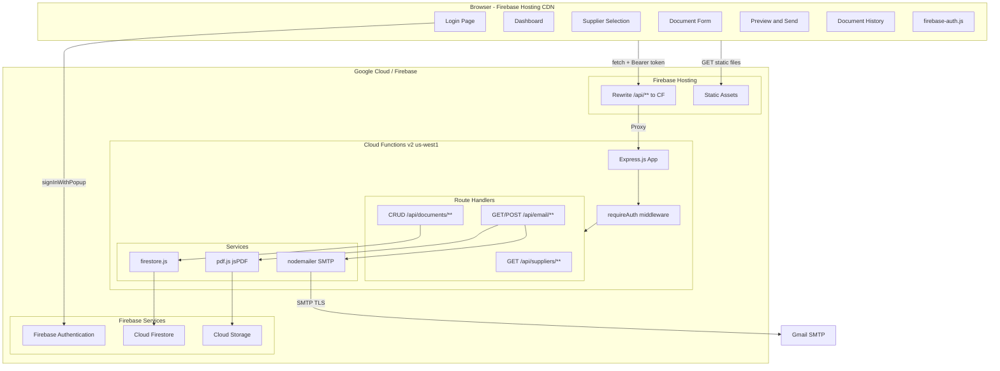
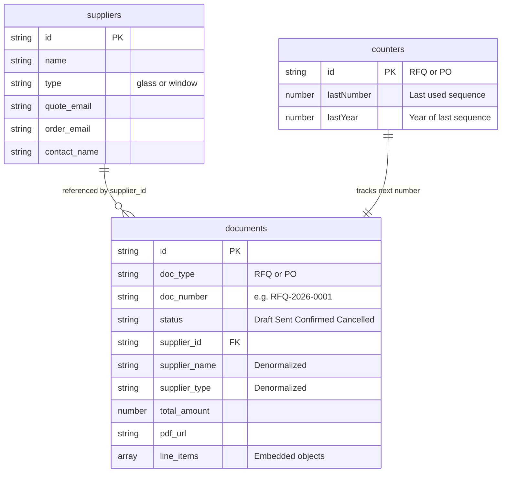
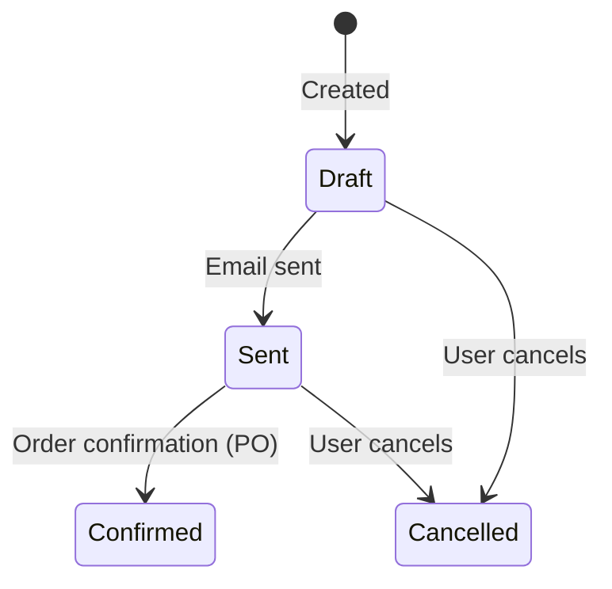
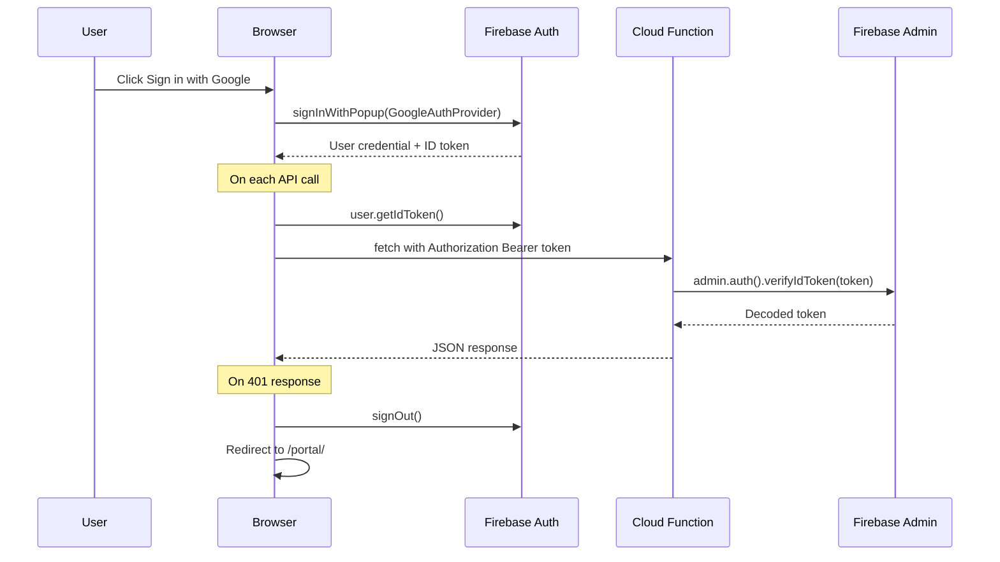
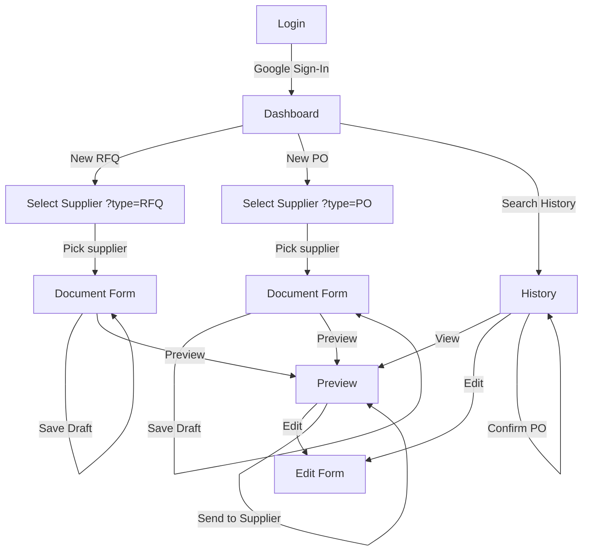
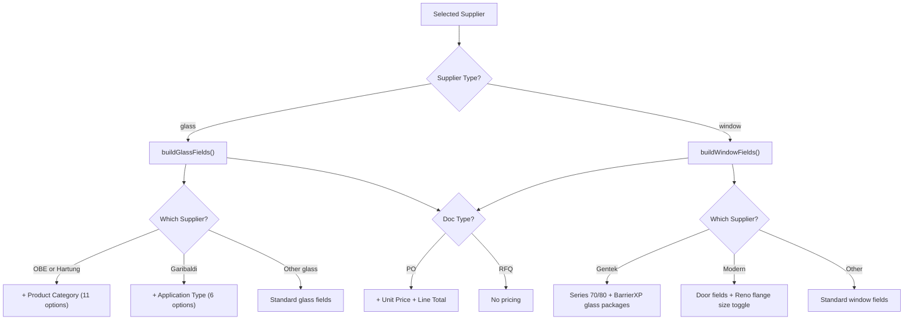

# Western Windows — Ordering & Quoting Portal

## Enterprise Technical Documentation

**Application:** Western Windows Supplier Portal  
**Version:** 2.1.0 (Firebase Edition — Post-Repair)  
**Owner:** Western Windows (Windows, Doors & Skylights)  
**Primary User:** Shane  
**Document Date:** March 7, 2026  
**Document Author:** Generated from full source-code audit — no code was modified  

---

## Table of Contents

1. [Executive Summary](#1-executive-summary)
2. [Business Objectives & Success Criteria](#2-business-objectives--success-criteria)
3. [Architecture Overview](#3-architecture-overview)
4. [Technology Stack](#4-technology-stack)
5. [File Inventory](#5-file-inventory)
6. [Data Model](#6-data-model)
7. [API Reference](#7-api-reference)
8. [Authentication System](#8-authentication-system)
9. [PDF Generation Pipeline](#9-pdf-generation-pipeline)
10. [Email Delivery System](#10-email-delivery-system)
11. [Frontend Screen Map & User Flows](#11-frontend-screen-map--user-flows)
12. [Form Engine — Supplier-Aware Logic](#12-form-engine--supplier-aware-logic)
13. [Supplier Catalog](#13-supplier-catalog)
14. [CSS Design System](#14-css-design-system)
15. [Security Model](#15-security-model)
16. [Deployment & Infrastructure](#16-deployment--infrastructure)
17. [Environment Configuration](#17-environment-configuration)
18. [Company Landing Page](#18-company-landing-page)
19. [Operational Runbook](#19-operational-runbook)
20. [Known Gaps & Future Roadmap](#20-known-gaps--future-roadmap)
21. [Changelog — v2.0 → v2.1](#21-changelog--v20--v21)

---

## 1. Executive Summary

The **Western Windows Portal** is an internal web application that replaces manual, email-based procurement workflows with a structured, branded system for creating, managing, and sending **Requests for Quote (RFQs)** and **Purchase Orders (POs)** to glass, window, and door suppliers.

The project now also hosts the **public-facing company website** (`src/index.html`) — a premium landing page with SEO, Schema.org structured data, and a Google Forms–backed contact form.

### What Changed Since v2.0 (Repair Cycle)

| Aspect | v2.0 | v2.1 (Current) |
|--------|------|----------------|
| **Node.js Runtime** | Node 20 | **Node 22** |
| **firebase-functions** | ^6.3.2 | **^7.1.0** |
| **CORS** | `origin: true` (permissive) | **Domain allowlist** (localhost + production URLs) |
| **Document Numbering** | Query highest doc_number | **Firestore transactions** with `counters` collection |
| **Input Validation** | Minimal | **`normalizeLineItems()` helper** + 400 errors for missing fields |
| **Email Security** | Basic | **Server-side `escapeHtml()`** + **`safeFilename()`** for headers |
| **Root Dependencies** | Legacy cruft (better-sqlite3, etc.) | **Cleaned up** — only dev/firebase deps remain |
| **Company Website** | None | **896-line landing page** with full SEO |
| **Express Hardening** | Default | **`x-powered-by` disabled** |

> [!IMPORTANT]
> The legacy `server/` directory has been **completely removed**. All backend logic lives in `functions/`.

---

## 2. Business Objectives & Success Criteria

### Core Problem

Western Windows staff manually draft procurement documents for glass, windows, and doors from multiple suppliers. Each supplier has different product catalogs, email addresses, and field requirements.

### Business Goals

| # | Goal | How the App Addresses It |
|---|------|--------------------------|
| 1 | **Eliminate manual RFQ/PO drafting** | Structured form with supplier-specific fields |
| 2 | **Professional, branded output** | Server-side PDF generation with WW logo, navy headers (#1B3A5C) |
| 3 | **Automatic document numbering** | Transaction-safe sequential: `RFQ-YYYY-NNNN` / `PO-YYYY-NNNN` |
| 4 | **One-click email delivery** | SMTP email with auto-attached PDF |
| 5 | **Document history & search** | Full search/filter with status tracking |
| 6 | **Supplier-specific intelligence** | Fields adapt per supplier |
| 7 | **Order confirmation tracking** | POs store supplier confirmation details |

### Success Criteria

- Create a complete RFQ or PO in **under 3 minutes**
- Every document assigned a unique, sequential number automatically
- PDFs match Western Windows branding and are emailable with one click
- All documents searchable by type, supplier, status, date, or free text

---

## 3. Architecture Overview



### Key Architectural Decisions

1. **Serverless backend** — Cloud Functions scale to zero; no always-on costs
2. **Firestore** — Documents + line items stored as embedded arrays (denormalized)
3. **Firebase Hosting rewrites** — `/api/**` proxies to Cloud Functions (same-origin)
4. **Firebase Auth** — Google Sign-In popup; ID tokens as Bearer headers
5. **Multi-page application** — separate `.html` files; no SPA framework
6. **Lazy initialization** — `jsPDF`, `nodemailer`, `firebase-admin` loaded lazily to avoid cold-start timeouts
7. **Transaction-safe numbering** — `counters` collection ensures no duplicate doc numbers

---

## 4. Technology Stack

### Backend (Cloud Functions)

| Package | Version | Purpose |
|---------|---------|---------|
| `express` | ^4.21.0 | HTTP routing & middleware |
| `firebase-admin` | ^13.4.0 | Firestore, Auth, Cloud Storage admin |
| `firebase-functions` | **^7.1.0** | Cloud Functions v2 HTTP trigger |
| `jspdf` | ^4.2.0 | Server-side PDF generation |
| `jspdf-autotable` | ^5.0.7 | Table plugin for jsPDF |
| `nodemailer` | ^8.0.1 | SMTP email transport |
| `cors` | ^2.8.6 | CORS with domain allowlist |
| `cookie-session` | ^2.1.0 | Lightweight session (legacy compat) |
| `dotenv` | ^17.3.1 | Local dev `.env` parsing |

**Runtime:** Node.js **22** · **Region:** us-west1 · **Memory:** 256 MiB · **Timeout:** 60s

### Frontend

| Technology | Details |
|------------|---------|
| HTML5 | Semantic, multi-page (6 portal pages + 1 landing page) |
| Vanilla CSS | 1,024-line portal design system + 1,631-line landing page styles |
| Vanilla JavaScript | ES modules for Firebase Auth; classic scripts for page logic |
| Firebase Auth SDK | v11.6.0 via CDN |
| Google Inter font | 300–800 weights (portal) |
| Google Montserrat/Open Sans | Landing page fonts |
| Google Places API | Address autocomplete on form page |

---

## 5. File Inventory

```
WW apps/
├── .env                          # Local dev environment variables
├── .firebaserc                   # Firebase project alias (western-windows-ca)
├── .gitignore                    # Comprehensive ignore rules
├── firebase.json                 # Hosting, Functions, Firestore, Storage config
├── firestore.rules               # Firestore security rules (deny all client)
├── firestore.indexes.json        # Composite index definitions
├── storage.rules                 # Cloud Storage security rules
├── package.json                  # Root manifest (dev scripts only)
│
├── functions/                    # BACKEND — Firebase Cloud Functions
│   ├── package.json              #   Functions manifest (Node 22)
│   ├── index.js                  #   Express app + Cloud Function export
│   ├── auth.js                   #   Firebase Auth middleware (verifyIdToken)
│   ├── firestore.js              #   Data access layer — all Firestore ops
│   ├── pdf.js                    #   PDF generation engine (jsPDF)
│   ├── ww-logo.png               #   Logo for PDF header (optimized)
│   └── routes/
│       ├── auth.js               #     Auth routes (login, logout, check)
│       ├── documents.js          #     Document CRUD + search + normalizeLineItems
│       ├── email.js              #     PDF gen, download, email send + escapeHtml
│       └── suppliers.js          #     Supplier list + lookup
│
└── src/                          # FRONTEND — Firebase Hosting
    ├── index.html                #   Company landing page (896 lines, SEO)
    ├── script.js                 #   Landing page JS (290 lines)
    ├── styles.css                #   Landing page CSS (1,631 lines)
    ├── logo.png                  #   Landing page logo
    └── portal/
        ├── index.html            #   Login — Google Sign-In
        ├── dashboard.html        #   Dashboard — action cards + recent activity
        ├── select-supplier.html  #   Supplier picker — glass vs window
        ├── form.html             #   Document form + Google Places
        ├── preview.html          #   PDF preview + send + download
        ├── history.html          #   Search/filter + results + confirm modal
        ├── ww-logo.png           #   Portal logo
        ├── css/
        │   └── styles.css        #   Portal design system (1,024 lines)
        └── js/
            ├── firebase-auth.js  #   Firebase Auth init + helpers (ES module)
            ├── utils.js          #   apiFetch, toasts, auth check, formatters
            ├── dashboard.js      #   Dashboard page logic
            ├── supplier.js       #   Supplier selection logic
            ├── form.js           #   CORE: Form engine (764 lines)
            ├── preview.js        #   Preview page — PDF, download, send
            └── history.js        #   History — search, results, confirm modal
```

---

## 6. Data Model

### Firestore Collections

Three top-level collections: `suppliers`, `documents`, and `counters`.



### Document Number Generation (Transaction-Safe)

```
Firestore Transaction:
  1. Read counters/{TYPE} document
  2. If year changed → reset sequence to 0
  3. Increment sequence
  4. Write back to counters/{TYPE}
  5. Return "{TYPE}-{YEAR}-{SEQUENCE zero-padded to 4}"
```

> [!IMPORTANT]
> This replaced the old approach of querying highest existing doc_number, which was susceptible to race conditions.

### Line Item Schema (Embedded Object)

| Field | Type | Used By | Description |
|-------|------|---------|-------------|
| `line_number` | number | All | Sequential position (1-based) |
| `qty` | number | All | Quantity (default: 1) |
| `width` / `height` | string | All | Dimensions |
| `glass_type` | string | Glass | Tempered, Laminated, Annealed, Heat-Strengthened |
| `thickness` | string | Glass | 3mm–12mm |
| `tint_coating` | string | Glass | Clear, Low-E, Grey/Bronze/Green Tint, Reflective |
| `shape` | string | Glass | Rectangle, Circle, Arch, Triangle, Custom |
| `edge_work` | string | Glass | Flat/Pencil Polish, Beveled, Seamed, None |
| `is_igu` | boolean | Glass | Insulated Glass Unit toggle |
| `igu_config` | string | Glass | Freeform IGU makeup (textarea) |
| `spacer_type` | string | Glass | SuperSpacer, Aluminum, Stainless Steel, Warm-Edge |
| `gas_fill` | string | Glass | Air, Argon, Krypton |
| `product_category` | string | OBE/Hartung | 11 options (IGU, Tempered, Shower, etc.) |
| `application_type` | string | Garibaldi | 6 options (Structural, Architectural, etc.) |
| `product_type` | string | Window | Single/Double Hung, Slider, Casement, etc. |
| `series` | string | Window | Gentek: 70/80. Modern: Vinyl/Aluminum/TB-Alum |
| `frame_color` | string | Window | White, Almond, Driftwood, Commercial Brown, Black |
| `frame_type` | string | Window | Nail Flange, Stucco/Reno Flange, Block Frame |
| `reno_flange_size` | string | Modern | When frame_type = Stucco/Reno Flange |
| `glass_package` | string | Window | Gentek: BarrierXP variants. Others: Standard/Low-E/Double/Triple |
| `grid_pattern` / `grid_type` | string | Window | Colonial/Prairie/Custom, GBG/SDL/Snap-In |
| `screen` | string | Window | Full, Half, None |
| `hardware_color` | string | Window | Match Frame, White, Black, Brass |
| `operating_style` | string | Window | Panel config: XO, OX, XOO, XOOX, etc. |
| `tempered` | boolean | Both | Tempered glass checkbox |
| `energy_star` | boolean | Window | Energy Star certification |
| `door_type/material/style` | string | Modern | Entry/Patio/French/Folding, Fiberglass/Steel/Wood |
| `unit_price` | number | PO only | Per-unit price |
| `line_total` | number | PO only | qty × unit_price |
| `notes` | string | All | Free-text |

### Document Status Lifecycle



---

## 7. API Reference

### Base URL

| Environment | URL |
|-------------|-----|
| **Local Dev** | `http://localhost:3000/api` |
| **Production** | `https://western-windows-ca.web.app/api` |

All endpoints (except health/auth-check) require a Firebase Auth **Bearer token**.

### Endpoints

| Endpoint | Method | Description |
|----------|--------|-------------|
| `/api/health` | GET | Health check (no auth) |
| `/api/auth/check` | GET | Returns `{ authenticated, email?, name? }` |
| `/api/auth/login` | POST | Legacy session login |
| `/api/auth/logout` | POST | Clear session |
| `/api/suppliers` | GET | List all (optional `?type=glass\|window`) |
| `/api/suppliers/:id` | GET | Single supplier |
| `/api/documents` | GET | Search with filters: `doc_type`, `supplier_id`, `status`, `search`, `date_from`, `date_to` |
| `/api/documents` | POST | Create doc + line items. Body: `{ document, lineItems }` |
| `/api/documents/next-number/:type` | GET | Next sequential number (transaction-safe) |
| `/api/documents/recent/list` | GET | 10 most recent (dashboard) |
| `/api/documents/:id` | GET | Get by ID with line items |
| `/api/documents/:id` | PUT | Update doc + replace line items |
| `/api/documents/:id` | DELETE | Delete document |
| `/api/documents/:id/confirmation` | PATCH | Update PO order confirmation |
| `/api/email/pdf-preview/:id` | GET | Generate PDF (inline) |
| `/api/email/pdf/:id` | GET | Generate PDF (download) |
| `/api/email/send/:id` | POST | Generate PDF → Storage → Email → status "Sent" |

### Input Validation (v2.1)

`POST /api/documents` now validates:
- `document` object required
- `doc_type` must be `RFQ` or `PO`
- `supplier_id` required
- `doc_number` required
- Line items normalized via `normalizeLineItems()` with safe defaults

---

## 8. Authentication System



**Key files:** `firebase-auth.js` (frontend ES module), `auth.js` (backend middleware), `utils.js` (`apiFetch()` auto-injects Bearer token)

---

## 9. PDF Generation Pipeline

| Section | Content |
|---------|---------|
| **Header** | WW logo + title + doc number |
| **From/To** | Two-column: Western Windows ↔ Supplier |
| **Details** | Date, Required By, Project, Requested By, Shipping |
| **Line Items** | Glass or Window layout with supplier-specific columns |
| **Total** | PO only: right-aligned total |
| **Notes** | Free-text special instructions |
| **Footer** | Company contact info |

**Security (v2.1):** Filenames sanitized via `safeFilename()` for `Content-Disposition` headers.

---

## 10. Email Delivery System

1. Generate PDF → buffer
2. Save to Cloud Storage: `portal/pdfs/{doc_number}.pdf`
3. Update Firestore with `pdf_url`
4. Check SMTP config — if unconfigured: graceful degradation (PDF saved, email skipped)
5. Create Nodemailer transporter (Gmail SMTP, STARTTLS)
6. Send with HTML body (server-side `escapeHtml()` on all user content) + PDF attachment
7. Update status to `Sent`

| Field | Value |
|-------|-------|
| **From** | `"Western Windows" <info@westernwindows.ca>` |
| **To** | Supplier's `quote_email` (RFQ) or `order_email` (PO) |
| **CC** | `shane@westernwindows.ca` |
| **Subject** | `{Request for Quote | Purchase Order}: {doc_number} — {project_name}` |

---

## 11. Frontend Screen Map & User Flows



### Pages

| Page | File | Key Features |
|------|------|-------------|
| Login | `portal/index.html` | Google Sign-In popup, auto-redirect if authenticated |
| Dashboard | `portal/dashboard.html` | New RFQ/PO cards, recent activity table |
| Select Supplier | `portal/select-supplier.html` | Glass vs Window supplier cards |
| Document Form | `portal/form.html` | Dynamic supplier-aware fields, Google Places autocomplete |
| Preview | `portal/preview.html` | PDF iframe preview, download, send-to-supplier |
| History | `portal/history.html` | 6-filter search, per-row actions, order confirmation modal |

---

## 12. Form Engine — Supplier-Aware Logic

`form.js` — **764 lines**, the most complex component.



### Interactive Behaviors

| Feature | Trigger | Effect |
|---------|---------|--------|
| IGU toggle | Checkbox | Shows IGU config textarea + spacer + gas fill |
| Price calc | qty/price input | Real-time line total |
| Frame type | "Stucco/Reno Flange" selected | Shows reno flange size (Modern) |
| Line add/remove | Buttons | Dynamic rows + auto-renumber |

---

## 13. Supplier Catalog

### Glass Suppliers

| Supplier | Quote Email | Order Email | Special Fields |
|----------|------------|-------------|----------------|
| Old Castle (OBE) | lanquotes@obe.com | lanorders@obe.com | Product Category (11 opts) |
| Hartung Glass | bbyquotes@hartung-glass.com | burnaby.glass@hartung-glass.com | Product Category (11 opts) |
| Garibaldi Glass | sales@garibaldiglass.com | orders@garibaldiglass.com | Application Type (6 opts) |

### Window & Door Suppliers

| Supplier | Contact | Special Fields |
|----------|---------|----------------|
| Gentek | Blair Gracie | Series: 70/80. Glass: BarrierXP variants |
| Modern Windows | Maegan | Door fields, Reno flange, Series: Vinyl/Aluminum/TB-Alum |

---

## 14. CSS Design System

**Portal:** `styles.css` — 1,024 lines

### Brand Palette

| Token | Hex | Usage |
|-------|-----|-------|
| `--navy` | `#1B3A5C` | Primary brand, headers |
| `--blue` | `#4682B4` | Focus states, gradients |
| `--blue-light` | `#6AAFE6` | Accent text, badges |
| `--amber` | `#F5A623` | Action buttons, PO badge, prices |
| `--bg-primary` | `#0D1B2A` | Page background (dark theme) |

### Component Library

Buttons (7 variants) · Cards · Badges (6 status/type variants) · Forms (grid layouts) · Tables · Toasts (4 types) · Modal · Spinner · Line Items Editor · Google Places autocomplete styling

---

## 15. Security Model

| Aspect | Implementation | Rating |
|--------|---------------|--------|
| **Authentication** | Firebase Auth + Google Sign-In | ✅ |
| **Token Verification** | `verifyIdToken()` on every API call | ✅ |
| **CORS** | **Domain allowlist** (localhost, `.web.app`, `.firebaseapp.com`) | ✅ Improved |
| **Firestore Rules** | `allow read, write: if false` | ✅ |
| **XSS (Frontend)** | `esc()` HTML-encodes all user content | ✅ |
| **XSS (Email)** | **Server-side `escapeHtml()`** on email templates | ✅ New |
| **Content-Disposition** | **`safeFilename()`** sanitizes filenames | ✅ New |
| **Express Hardening** | **`x-powered-by` disabled** | ✅ New |
| **Input Validation** | `normalizeLineItems()` + 400 errors for missing fields | ✅ Improved |
| **Storage Rules** | PDFs publicly readable by URL | ⚠️ |
| **API Key** | Firebase config in frontend HTML | ⚠️ Expected |

---

## 16. Deployment & Infrastructure

### Firebase Project

| Setting | Value |
|---------|-------|
| **Project ID** | `western-windows-ca` |
| **Region** | `us-west1` |
| **Hosting** | `western-windows-ca.web.app` |
| **Runtime** | **Node.js 22** |

### Commands

```bash
firebase deploy              # Everything
firebase deploy --only functions
firebase deploy --only hosting
npm run dev                  # Local dev → http://localhost:3000
```

### Cloud Function Properties

| Property | Value |
|----------|-------|
| Function name | `api` |
| Region | `us-west1` |
| Timeout | 60 seconds |
| Memory | 256 MiB |
| Secrets | `SMTP_HOST`, `SMTP_PORT`, `SMTP_USER`, `SMTP_PASS`, `EMAIL_FROM`, `EMAIL_CC` |

---

## 17. Environment Configuration

| Variable | Default | Description |
|----------|---------|-------------|
| `LOCAL_DEV` | `true` | Enables local static serving |
| `PORT` | `3000` | HTTP port |
| `SMTP_HOST` | `smtp.gmail.com` | SMTP server |
| `SMTP_PORT` | `587` | SMTP port |
| `SMTP_USER` | `info@westernwindows.ca` | SMTP auth |
| `SMTP_PASS` | placeholder | Gmail app password |
| `EMAIL_FROM` | `info@westernwindows.ca` | Sender |
| `EMAIL_CC` | `shane@westernwindows.ca` | CC on all outbound |

> [!WARNING]
> In production, SMTP variables are **Google Cloud Secrets** — not `.env`. The placeholder `SMTP_PASS` triggers graceful degradation.

---

## 18. Company Landing Page

**File:** `src/index.html` — 896 lines

A full premium company website served at the root URL (`/`):

| Section | Features |
|---------|----------|
| **SEO** | Title tags, meta descriptions, OG tags, Twitter cards |
| **Schema.org** | `HomeAndConstructionBusiness` structured data with services, hours, area served |
| **Hero** | Animated stat counters (25+ years, 100% satisfaction), CTA buttons |
| **Services** | Windows, Doors, Skylights with feature lists |
| **Gallery** | CSS grid image gallery with overlays |
| **Testimonials** | Carousel with navigation dots |
| **Contact** | Google Forms integration with client-side validation |
| **Accessibility** | Skip-to-content link, ARIA labels, semantic HTML |
| **JS** | `script.js` — 290 lines (nav scroll, stats animation, form validation) |
| **CSS** | `styles.css` — 1,631 lines |

---

## 19. Operational Runbook

### Local Development

```bash
cd "c:\Users\shane\AntiG\WW apps"
npm run dev
# Portal → http://localhost:3000/portal/
# Website → http://localhost:3000/
```

### Supplier Seeding

Auto-seeds on first request if `suppliers` collection is empty. Batch writes 5 suppliers.

### Adding a New Supplier

Modify `firestore.js` seed array and redeploy, or add directly via Firebase Console.

### Monitoring

- **Logs:** Firebase Console → Functions → Logs
- **Data:** Firebase Console → Firestore Database
- **Storage:** Firebase Console → Storage (`portal/pdfs/`)
- **Health:** `GET /api/health`

---

## 20. Known Gaps & Future Roadmap

### ✅ Fully Implemented

| Feature | Status |
|---------|--------|
| Google Sign-In authentication | ✅ |
| Dashboard with recent activity | ✅ |
| Supplier selection (5 suppliers, 2 types) | ✅ |
| Dynamic forms — glass (3 variants) + window (2 variants) | ✅ |
| Transaction-safe document numbering | ✅ |
| Save draft / edit existing | ✅ |
| PDF generation (glass + window layouts) | ✅ |
| PDF preview, download, email send | ✅ |
| SMTP graceful degradation | ✅ |
| Document history with 6-parameter search | ✅ |
| Order confirmation modal (POs) | ✅ |
| Dark theme design system | ✅ |
| Toast notifications (4 variants) | ✅ |
| Google Places address autocomplete | ✅ |
| XSS protection (frontend + backend) | ✅ |
| CORS domain allowlist | ✅ |
| Input validation with normalizeLineItems() | ✅ |
| Company landing page with full SEO | ✅ |

### 🔲 Known Gaps

| Gap | Severity |
|-----|----------|
| No supplier management UI | Medium |
| Modern door fields hidden by default (no visible toggle) | Medium |
| No pagination on history (capped at 100) | Low |
| No duplicate-detection on rapid submission | Low |
| No reporting / analytics dashboard | Medium |
| PDFs publicly readable in Cloud Storage | Low |
| Legacy session auth routes still wired | Low |
| `cookie-session` still in dependencies | Low |

---

## 21. Changelog — v2.0 → v2.1

| Change | Details |
|--------|---------|
| **Node.js 22** | Runtime upgraded from Node 20 |
| **firebase-functions ^7.1.0** | Upgraded from ^6.3.2 |
| **CORS allowlist** | Replaced `origin: true` with explicit domain list |
| **x-powered-by disabled** | Express hardening |
| **Transaction doc numbering** | `counters` collection replaces query-based approach |
| **normalizeLineItems()** | Shared helper with safe defaults for all 30+ fields |
| **Input validation** | 400 errors for missing `doc_type`, `supplier_id`, `doc_number` |
| **escapeHtml()** | Server-side HTML encoding in email templates |
| **safeFilename()** | Sanitizes Content-Disposition filenames |
| **Root deps cleaned** | Removed `better-sqlite3`, `express-session`, `jspdf`, `multer`, `nodemailer` from root |
| **Company website** | 896-line landing page with SEO, Schema.org, Google Forms contact |
| **noindex/nofollow** | Added to all portal pages |

---

> [!NOTE]
> This document was generated by reading every source file in `c:\Users\shane\AntiG\WW apps\`. **No code was modified** during this documentation effort. Document date: March 7, 2026.
